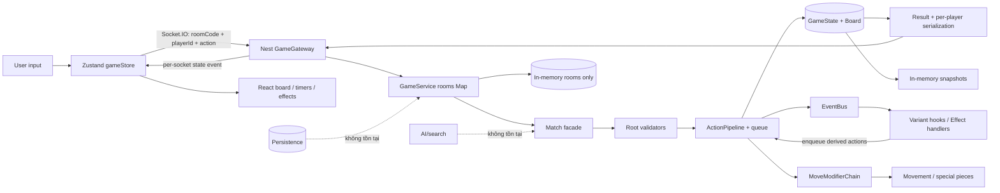

# 00 — Tổng quan audit

## Kết luận ngắn

**[CONFIRMED]** Repository là một monorepo TypeScript cho game cờ biến thể 1v1 thời gian thực: `game-core` giữ luật, NestJS/Socket.IO giữ room và authoritative match, Next.js/Zustand hiển thị client. Core có phạm vi lớn (27 variant, action/effect pipeline và 543 test đang pass), nhưng trạng thái hiện tại **chưa đủ an toàn để coi là playable release**: client có thể mạo danh `playerId`, gửi action sai lượt, trap ẩn bị lộ qua history, timer lượt đầu không chạy, surrender không kết thúc authoritative match, mirror match chia sẻ state, và build/test/e2e/lint không xanh. Nền tảng kiến trúc có giá trị, nhưng báo cáo cũ “95% hoàn thành” tại `AUDIT.md:27-32` không phản ánh các lỗi tích hợp và security đã tái hiện.

## Phạm vi và phương pháp

**[CONFIRMED]** Đã duyệt toàn bộ 174 file first-party `.ts`/`.tsx` trong `packages/game-core/src`, `apps/backend/src`, `apps/frontend/src`, cùng CSS, config, test, tài liệu và Git history. Quy mô đo được: core 108 file/16.224 dòng; backend `src` 48 file/17.563 dòng (phần lớn là spec); frontend 19 file/7.511 dòng. Ngoài việc đọc và lập import/symbol map, audit tập trung dòng-mã vào toàn bộ engine, 27 variant, 40+ effect handler, gateway/service, Zustand store và toàn bộ tên/assertion của 544 unit test.

**[CONFIRMED]** Không sửa source/config. Lệnh build đã chạm `apps/backend/dist/tsconfig.build.tsbuildinfo`; file này đã được khôi phục nguyên trạng bằng Git. Trạng thái cuối trước khi viết báo cáo vẫn giữ nguyên thay đổi có sẵn của chủ repository (`M docs/Variants.md`, `?? Effect.md`, `?? Variants.md`) và chỉ thêm `docs/audit/`.

**[UNKNOWN]** Chưa chạy một phiên hai browser tương tác đầy đủ, chưa load-test/profiler, và chưa kiểm tra deployment thật vì repository không có environment/deployment contract. Các khoảng trống này được ghi ở `05-open-questions.md`; chúng không làm thay đổi các lỗi đã tái hiện bằng runtime.

## Tech stack, build system và entry points

| Thành phần | Trạng thái xác nhận | Nguồn |
|---|---|---|
| Workspace | npm workspaces, script root chạy core → backend → frontend | `package.json:5-14` |
| Core | TypeScript, CommonJS, declaration output, package entry `dist/index.js` | `packages/game-core/package.json:5-16`, `packages/game-core/tsconfig.json:3-12` |
| Backend | NestJS 11, Socket.IO 4, RxJS; entry `bootstrap()` | `apps/backend/package.json:22-31`, `apps/backend/src/main.ts:1-16` |
| Frontend | Next.js 16 App Router, React 19, Zustand 5, Tailwind 4, Framer Motion | `apps/frontend/package.json:5-28`, `apps/frontend/src/app/page.tsx:1-42` |
| Test | Jest 30 + ts-jest 29; unit specs nằm trong `src`; một e2e spec | `apps/backend/package.json:16-20,47-53,58-76`, `apps/backend/test/jest-e2e.json:1-9` |
| Entry core | Public API barrel; `Match` là facade của game | `packages/game-core/src/index.ts:5-161`, `packages/game-core/src/match/Match.ts:65-116` |
| Entry backend | HTTP/Nest app port `PORT || 3001`; Socket gateway nhận toàn bộ game commands | `apps/backend/src/main.ts:4-15`, `apps/backend/src/game/game.gateway.ts:17-27` |
| Entry frontend | `RootLayout` và client page; socket singleton mặc định `localhost:3001` | `apps/frontend/src/app/layout.tsx:1-40`, `apps/frontend/src/app/page.tsx:19-42`, `apps/frontend/src/lib/socket.ts:5-20` |

## Cây thư mục và mục đích

```text
Variants/
├─ apps/
│  ├─ backend/
│  │  ├─ src/game/              # Room lifecycle, timer và Socket.IO gateway
│  │  ├─ src/*.spec.ts          # Unit/integration specs cho engine và từng variant
│  │  └─ test/                  # E2E Nest app (hiện không khởi chạy được)
│  └─ frontend/
│     ├─ public/assets/          # Piece, variant, skill và effect bitmap
│     └─ src/
│        ├─ app/                 # Next App Router, layout và trang game duy nhất
│        ├─ components/          # Board, square, piece, lobby/draft/reveal, panels
│        ├─ debug/               # Overlay/mask layout phục vụ debug UI
│        ├─ lib/                 # Socket singleton và catalog variant lặp lại phía client
│        └─ store/               # Zustand state + toàn bộ socket listeners/client prediction
├─ packages/game-core/
│  ├─ src/action/               # Action union, queue, history và pipeline/validators
│  ├─ src/board/                # Lưới 15×15, cell effects, tọa độ algebraic
│  ├─ src/combat/               # Attack/check query dùng cho effect, không phải checkmate
│  ├─ src/effect/handlers/      # Handler buff/debuff/event cụ thể
│  ├─ src/event/                # Event types, priority và synchronous EventBus
│  ├─ src/match/                # Facade Match, clock, move history, serialization
│  ├─ src/modifier/             # Chain sửa pseudo-legal moves theo effect/terrain
│  ├─ src/movement/             # Generator cho sáu loại quân và Ghost
│  ├─ src/pieces/               # Piece/owner, setup ban đầu, special-piece registry
│  ├─ src/region/               # Helper vùng vuông/chữ thập/chữ X/hướng
│  ├─ src/rng/                  # PRNG seed + counter
│  ├─ src/state/                # GameState, graveyard và snapshot
│  ├─ src/validation/           # Move validation
│  └─ src/variant/              # Registry, skill contracts, AP table và 27 variant
├─ docs/                        # GDD/rules/effects; hiện có chỉnh sửa chưa commit
├─ AUDIT.md                     # Audit cũ, có kết luận quá lạc quan và thiếu lỗi runtime
├─ GDD.md                       # Bản GDD ở root (trùng phạm vi với docs/GDD.md)
├─ package.json                 # Workspace scripts
└─ package-lock.json            # Dependency lock
```

**[CONFIRMED]** `packages/game-core/dist` và `apps/backend/dist` đang được track (470 file), dù là build artifacts. `dist` còn `ColossusVariant`, `GuardianLinkHandler`, `MountainHandler`, `RootHandler` không có source tương ứng; package core lại trỏ runtime vào `dist` (`packages/game-core/package.json:5-12`). Đây là nguồn drift/runtime ambiguity.

## Kiến trúc và data flow thực tế



**[CONFIRMED]** Server được thiết kế authoritative ở cấp `Match`, nhưng identity authorization không nằm trên đường critical: gateway chuyển thẳng `roomCode/playerId` do payload client cung cấp (`apps/backend/src/game/game.gateway.ts:231-258,329-381`), service tìm player theo chuỗi đó (`apps/backend/src/game/game.service.ts:252-285,312-355`), còn `Match.makeMove` không dùng `playerColor` để validate (`packages/game-core/src/match/Match.ts:149-150,237-278`; `ActionPipeline.ts:1587-1595`).

## Trạng thái build, type-check, lint và test

Môi trường: Node `v24.14.0`, npm `11.9.0`, Git `2.53.0.windows.2`.

| Lệnh chính xác | Exit | Kết quả chính xác/đo được |
|---|---:|---|
| `npm run build` | 1 | `game-core` và Nest backend build thành công; Next build thất bại vì `next/font` không fetch được Google Fonts `Geist`, `Geist Mono`, `Press Start 2P` tại `apps/frontend/src/app/layout.tsx:2-18`. Đây là lỗi build trong môi trường audit; chưa chứng minh lỗi code khi có network. |
| `npx tsc -p tsconfig.json --noEmit` (cwd `packages/game-core`) | 0 | Core type-check pass. |
| `npx tsc -p apps/backend/tsconfig.build.json --noEmit --incremental false` | 0 | Backend production type-check pass. |
| `npx tsc -p apps/frontend/tsconfig.json --noEmit --incremental false` | 0 | Frontend type-check pass. |
| `npm -w apps/backend test -- --runInBand` | 1 | 40/41 suite pass; 543/544 test pass. Fail duy nhất: `apps/backend/src/ap-cost-migration.spec.ts:16`, expected 26 variant, received 27. |
| `npm -w apps/backend run test:e2e -- --runInBand` | 1 | 0 test chạy; suite fail: `Cannot find module './game/game.module.js' from 'src/app.module.ts:2'`. Unit config có mapper `.js`, e2e config không có (`apps/backend/package.json:69-71`; `apps/backend/test/jest-e2e.json:1-9`). |
| `npx eslint "{src,apps,libs,test}/**/*.ts"` (cwd `apps/backend`) | 1 | 2.857 vấn đề: 2.818 errors, 39 warnings; 2.254 auto-fixable. Không auto-fix theo constraint. |
| `npm -w apps/frontend run lint` | 1 | 125 vấn đề: 86 errors, 39 warnings; gồm `no-explicit-any`, hook/effect issues và `set-state-in-effect` tại `ActionBar.tsx:140-144`. |
| `npm audit --json` | 1 | Toàn cây: 27 vulnerabilities = 1 critical, 23 high, 2 moderate, 1 low. |
| `npm audit --omit=dev --json` | 1 | Production tree: 14 vulnerabilities = 1 critical, 10 high, 2 moderate, 1 low. Direct `next@16.2.7` có critical advisories; fix npm đề xuất `16.3.8`. Socket stack có DoS advisories; Nest Express kéo `multer` advisories. |
| `npm outdated --json --workspaces` | 1 | Có version mới: Next `16.3.8`; Nest 11 packages có minor mới và major 12; Socket.IO `4.8.4`; React `19.3.0`; nhiều tool có major mới. “Outdated” không tự đồng nghĩa lỗi. |

Lệnh chẩn đoán phụ: `npx tsc -p packages/game-core/tsconfig.json --noEmit --incremental false` bị TypeScript từ chối do project `composite`; chạy đúng từ cwd package không override `incremental` thì pass. Một lần chạy ESLint backend từ root không tìm thấy config; kết quả lint chính thức ở bảng được chạy từ `apps/backend`.

### Runtime reproductions đã chạy

Các lệnh dưới đây chạy trên `packages/game-core/dist` vừa build từ source hiện tại; output được chép nguyên văn (ID timestamp tự nhiên thay đổi nếu chạy lại):

```powershell
node -e "const {Match,Color}=require('./packages/game-core/dist'); const m=new Match(); m.start(); const r=m.makeMove(Color.Black,{col:0,row:1},{col:0,row:2}); console.log(JSON.stringify({wrongColorMoveSuccess:r.success,currentTurn:m.getCurrentTurn(),pieceAtA3:m.getGameState().board.getPiece({col:0,row:2})?.id}));"
```

```json
{"wrongColorMoveSuccess":true,"currentTurn":"White","pieceAtA3":"w_pawn_0"}
```

```powershell
node -e "const {Match,Color}=require('./packages/game-core/dist'); const m=new Match(); m.setVariants('lightning','guardian'); m.start(); m.getGameState().whiteAP=100; m.getGameState().blackAP=100; const r=m.useSkill(Color.Black,'guardian_shield',[{type:'piece',pieceId:'b_rook_0',position:{col:0,row:14}}]); console.log(JSON.stringify({outOfTurnBlackSkillSuccess:r.success,currentTurn:m.getCurrentTurn(),blackRookEffects:m.getGameState().board.getPiece({col:0,row:14})?.effects}));"
```

Output xác nhận `outOfTurnBlackSkillSuccess:true`, `currentTurn:"White"`, Black Rook nhận effect `shield`.

```powershell
node -e "const {Match,Color}=require('./packages/game-core/dist'); const m=new Match(); m.setVariants('lightning','guardian'); m.start(); m.getGameState().whiteAP=100; const r=m.useSkill(Color.White,'lightning_thunder_trap',[{type:'cell',position:{col:4,row:4}}]); const enemy=m.serializeForPlayer(Color.Black); const leaked=enemy.actionHistory.filter(x=>x.action?.effect?.type==='thunder_trap'); console.log(JSON.stringify({trapUseSuccess:r.success,blackBoardShowsTrap:enemy.board.cellEffects['4,4']||null,blackActionHistoryLeak:leaked}));"
```

Output xác nhận `trapUseSuccess:true`, `blackBoardShowsTrap:null`, nhưng `blackActionHistoryLeak[0].action.effect.targetId` là `"4,4"`.

```powershell
node -e "const {GameState,SnapshotManager,Color}=require('./packages/game-core/dist'); const s=new GameState(1), p={id:'p',type:'Pawn',color:Color.White,effects:[{id:'e',type:'x',duration:2,remainingDuration:2,tickTiming:'turnEnd',sourcePlayer:Color.White,targetType:'piece',targetId:'p',stackingRule:'refresh',isDebuff:false,metadata:{nested:{count:1}}}]}; s.board.setPiece({col:0,row:0},p); const sm=new SnapshotManager(); sm.capture(s); p.effects[0].metadata.nested.count=99; const restored=sm.restore(0); console.log(JSON.stringify({restoredNestedCount:restored.board.getPiece({col:0,row:0}).effects[0].metadata.nested.count}));"
```

```json
{"restoredNestedCount":99}
```

## Dependency risk

**[CONFIRMED]** `next@16.2.7` là direct production dependency (`apps/frontend/package.json:14`) và `npm audit --omit=dev` báo critical, gồm Windows-hosted unauthenticated RCE, AVIF/ImageResponse RCE cùng các advisory high/moderate; npm đưa fix `16.3.8`. Mức khai thác thực tế phụ thuộc feature/deployment, chưa được xác minh.

**[CONFIRMED]** Backend direct dependency `@nestjs/platform-express` (`apps/backend/package.json:25`) kéo `multer` có DoS advisories; `socket.io`/`socket.io-client` (`apps/backend/package.json:31`, `apps/frontend/package.json:17`) kéo `engine.io`, `ws`, parser/adapter advisories. Cần cập nhật lockfile sau khi có safety tests, không nên nâng major đồng loạt.

## Git/history và trạng thái công việc cuối

**[CONFIRMED]** Chỉ có `main` và `origin/main`, cùng trỏ `a8fe81a`; không thấy branch dang dở khác. Lịch sử gần nhất:

| Commit | Thời gian (+07:00) | Ý nghĩa |
|---|---|---|
| `a8fe81a` | 2026-07-23 10:34 | “Cập nhật các tính năng và sửa lỗi mới”; 506 file, +42.176/-1.711, thêm phần lớn variant/spec/assets, Pirate và audit cũ. |
| `87ab5cb` | 2026-06-19 21:17 | tag `v0.1.0-alpha`. |
| `f90870b` | 2026-06-06 17:27 | sửa animation board. |
| `c00ff2f` | 2026-06-06 16:00 | mở CORS toàn origin. |
| `b628dec` / `b9ba7ea` | 2026-06-06 | dynamic port/CORS và socket URL env. |

**[SUSPECTED]** Dựa trên commit cuối, test hard-code 26→27, tài liệu Pirate chưa commit và artifacts Colossus, công việc bị dừng giữa một đợt tích hợp lớn chứ không phải ở một release ổn định. Chi tiết ở `03-unfinished-work.md`.

## Đánh giá sức khỏe theo khu vực

| Khu vực | Sức khỏe | Căn cứ |
|---|---|---|
| A — Rules | Đỏ | Wrong-player/out-of-turn action tái hiện được; no repetition dù GDD yêu cầu; snapshot không sâu; nhiều edge case effect. |
| B — State/architecture | Đỏ-vàng | Pipeline/registry có cấu trúc tốt, nhưng shared flat `variantState`, global registries và import cycles làm coupling cao. |
| C — AI/search | Xám | **[CONFIRMED]** Không có AI/search/evaluation/TT/time management trong source hay entry point. |
| D — UI/network/storage | Đỏ | Identity không bind socket, surrender/timer sai authoritative state, listener/delayed update dễ desync, không persistence. |
| E — Performance | Vàng | Board 15×15 nhỏ nhưng nhiều full scans/serialization per event; chưa profiler nên chưa kết luận bottleneck thực. |
| F — Maintainability | Đỏ-vàng | 1.885 dòng pipeline, 1.404 dòng store, 1.130 dòng duplicated variant catalog, lint rất đỏ, tracked dist stale. |
| G — Testing | Vàng | 543 test pass là nền tốt; nhưng e2e không chạy, test migration fail, không perft/protocol/security tests. |
| H — Security | Đỏ | Impersonation, hidden-information leak, open CORS, vulnerable prod dependencies, thiếu schema/rate limit. |

**Đánh giá tổng thể: prototype alpha giàu tính năng nhưng trạng thái tích hợp không đáng tin cậy.** Không nên thêm feature hoặc tối ưu trước khi đóng authorization/state-integrity và dựng safety net ở roadmap.
