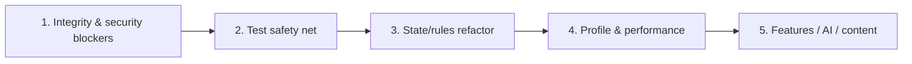

# 04 — Roadmap phục hồi dự án

Roadmap này chỉ là hướng sửa **sau** audit; chưa có thay đổi code nào được thực hiện. Effort tương đối: S ≤ 1 ngày, M ≈ 2–5 ngày, L ≥ 1 tuần cho một kỹ sư quen codebase.

## Nguyên tắc thứ tự

Không tối ưu hoặc thêm Joker/Colossus trước khi P0/P1 xong: hiện chưa có cách tin rằng action đến từ đúng người, rollback đúng, hoặc hidden state thật sự được ẩn.

## 1. Blocker và correctness

| Pri | Task | Effort | Phụ thuộc | Exit criteria |
|---:|---|---:|---|---|
| 0.1 | Bind socket/session với player; reconnect token an toàn; authorize mọi gateway command | L | Quyết định auth/reconnect ở Q-01/Q-02 | Không command nào dùng payload identity làm authority; adversarial test impersonation pass. |
| 0.2 | Enforce `requester === currentTurn` cho move/capture/bite/skill/pass/sacrifice/end/surrender | M | 0.1 hoặc ít nhất requester contract | Runtime reproductions A-01/A-02 fail đúng, không mutate/AP spend. |
| 0.3 | Thiết kế per-viewer DTO allowlist; loại internal history/snapshot/hidden metadata | M | Không | Trap/stealth/position snapshot không leak bằng JSON snapshot tests. |
| 0.4 | Authoritative terminal transition chung cho King death, timeout, surrender, disconnect, draw | M | 0.2 | `status/winner/reason/room.phase` nhất quán; action sau terminal bị reject. |
| 0.5 | Clock duy nhất, monotonic, bắt đầu từ first turn; loại double-accounting/`moveHistory` sentinel | M | 0.4 | Fake-clock tests cho first move, invalid action, override, reconnect, increment. |
| 0.6 | Deep immutable snapshots + monotonic ply key; định nghĩa Time rewind | L | Quyết định round/ply Q-03 | Mutation isolation, White/Black restore, Time skills pass fixtures. |
| 0.7 | Namespace `variantState` theo player/variant; scope handlers/registries | L | Chốt mirror Q-04 | Self-match của mọi stateful variant không chia counter/timer/effect owner. |
| 0.8 | Queue transaction/rollback khi overflow/error; validate root action taxonomy | L | 0.6 hữu ích | Chain > limit trả failure và state hash giữ nguyên; Zombie bite cùng turn rule. |
| 0.9 | Chốt và sửa rule mismatches ưu tiên: Space, Verdant, Puppet, Predator, Thunder Dragon | L | Product answers Q-05..Q-10 | Docs/core/client metadata cùng schema và golden tests. |
| 0.10 | Patch production dependency vulnerabilities theo nhóm | M | P1 smoke tests tối thiểu | `npm audit --omit=dev` không còn critical/high applicable; build/test xanh. |

## 2. Safety net

| Pri | Task | Effort | Phụ thuộc | Exit criteria |
|---:|---|---:|---|---|
| 1.1 | Làm unit suite xanh và bỏ hard-code count 26 | S | Không | 544/544 hoặc số mới đều pass. |
| 1.2 | Sửa e2e module resolution mà không làm lệch runtime NodeNext | S/M | Không | `npm -w apps/backend run test:e2e -- --runInBand` chạy test thật. |
| 1.3 | E2E hai Socket client + malicious third client | L | 0.1–0.5, 1.2 | Full create→draft→play→terminal/reconnect; takeover bị reject. |
| 1.4 | Variant-aware perft nền | L | Rule nền frozen | Golden node counts depth 1–4 cho setup nhỏ/đủ; Bishop lateral, Ghost và special piece fixtures riêng. |
| 1.5 | State invariants/property tests | M/L | 0.6–0.8 | Failed action atomic; unique piece location/id; King terminal; AP/clock bounds; snapshot round-trip. |
| 1.6 | Hidden-information contract tests | M | 0.3 | Deep traversal payload không chứa hidden coordinates/IDs/actions. |
| 1.7 | Mirror-match test matrix | L | 0.7 | Ít nhất 27 self-match smoke + focused stateful interactions. |
| 1.8 | Frontend store ordering tests | M | Thêm revision protocol | Delayed animations không rollback state mới; listeners idempotent. |
| 1.9 | CI gates | M | 1.1–1.3 | build, type-check, lint baseline, unit/e2e/audit chạy reproducibly; không commit dirty dist. |

### Perft đề xuất cho biến thể

1. Tạo `PositionFixture` gồm board, effective owner, effects, variant state và side-to-move.
2. Bắt đầu với profile “base rules” không skill/effect; đếm pseudo-legal leaf nodes vì game cố ý không có self-check.
3. Mỗi node clone/transaction apply move, verify invariant, recurse và so state hash trước/sau. Nếu sau này có make/unmake, cùng fixture phải chạy cả clone và make/unmake để differential-test.
4. Thêm profile độc lập: Bishop lateral, auto-promotion/AP, Ghost one-obstacle, portal interception, mountain/flame/outworld, Walker/Puppet owner, Cannibal King, Thunder Fang.
5. Không trộn random skill vào perft; dùng scripted RNG seed và golden action chains riêng.

## 3. Refactor sau khi có test

| Pri | Task | Effort | Phụ thuộc | Kết quả mong muốn |
|---:|---|---:|---|---|
| 2.1 | Tách `ActionPipeline` thành root command validation, reducer, reaction scheduler, terminal resolver | L | 1.4–1.7 | Mỗi module có invariant và transaction boundary rõ. |
| 2.2 | Tách `gameStore` network state, selection model, animation queue, UI state | L | 1.8 | Không stale closure/timer overwrite; giảm `any`. |
| 2.3 | Một source of truth cho variant metadata/AP/description | M | 0.9 | Frontend nhận/generated từ typed core schema; xóa drift `variantsData`. |
| 2.4 | Tách shared contracts khỏi `Match`/`GameState`, chuyển type-only imports | M | 1.x | Giảm circular graph và runtime initialization risk. |
| 2.5 | Encapsulate Board/effect collections; immutable/read-only views | M | 1.5 | Không caller mutate Map/array trực tiếp. |
| 2.6 | Inject RNG/clock/ID generator | M | 1.5 | Replay cùng seed/event log byte-for-byte ổn định. |
| 2.7 | Versioned persistence DTO + Match restore/event log | L | 2.1,2.6 | Restart/resume/replay; migration version rõ. |
| 2.8 | Artifact/docs hygiene | S/M | Không | Chọn track/untrack dist; clean build; canonical `docs/`; archive audit cũ. |
| 2.9 | Trả lint về baseline 0 hoặc ratchet | M/L | 2.1–2.3 | Không auto-fix mù; xử lý semantic rule trước formatting. |

## 4. Performance — chỉ sau profiler

| Pri | Task | Effort | Phụ thuộc | Benchmark target |
|---:|---|---:|---|---|
| 3.1 | Benchmark `serializeForPlayer`, skill target computation, attack scan và long action chain | M | Determinism + fixtures | p50/p95 CPU, allocations, payload bytes theo representative match. |
| 3.2 | Piece/effect index theo ID và position | M | 3.1 chứng minh hotspot | Thay các full-board `findPieceById` trong hot chain. |
| 3.3 | Cache attack/legal-target có explicit invalidation | L | 3.1; rules frozen | Không stale cache qua effect/portal/control; measured gain. |
| 3.4 | Delta/revision network state thay full per-player clone mỗi event | L | 0.3, frontend revision | Payload/GC giảm, reconnect vẫn nhận full snapshot. |
| 3.5 | Bound/prune histories/snapshots và room lifecycle | M | Persistence model | Memory không tăng vô hạn trong soak test. |

Profiler nên đặt trước ở `Match.serializeForPlayer` (`Match.ts:670-770`), `getValidPositionsForRequirement` (`Match.ts:491-667`), `getAttackedPieces` (`AttackDetection.ts:244-270`), `ActionPipeline.findPieceById/getActiveEffects` (`ActionPipeline.ts:238-273`) và gateway double serialization (`game.gateway.ts:29-50`).

## 5. Features sau khi nền ổn định

| Pri | Feature | Effort | Phụ thuộc |
|---:|---|---:|---|
| 4.1 | Threefold repetition/draw UI | M/L | Chốt canonical position key + terminal model |
| 4.2 | Joker | L | Effect schema, hidden-info DTO, deterministic RNG |
| 4.3 | Colossus/Titan 2×2 | XL | Multi-cell piece representation + perft/invariants; không dùng stale dist làm source truth |
| 4.4 | Replay/export notation variant-FEN/event-PGN | L | Versioned persistence + deterministic event log |
| 4.5 | Spectator/match history | L | Viewer authorization/redaction + persistence |
| 4.6 | AI | XL | Rules frozen, fast clone/make-unmake, perft và determinism; sau đó mới search/eval/TT/time management |

## Việc nên làm đầu tiên khi quay lại code

1. Tạo nhánh phục hồi và đóng băng feature.
2. Viết regression tests tái hiện H-01/A-01/A-02/H-02 trước khi sửa.
3. Hoàn thành 0.1–0.5 để có authoritative protocol đúng.
4. Làm unit/e2e xanh, rồi 0.6–0.8 và perft/invariants.
5. Chỉ sau đó quyết định rule mismatch nào sửa code, mismatch nào sửa docs.
