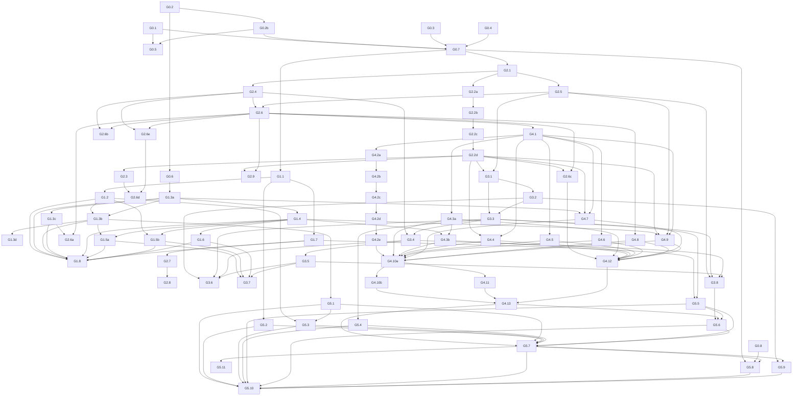

# 07 — Roadmap cuối sau quyết định

Quy ước citation: tên file core rút gọn trong bảng/đoạn dài được resolve dưới `packages/game-core/src`; tên spec dưới `apps/backend/src`; `variantsData.ts` dưới `apps/frontend/src/lib`. Mỗi nhận định về code bên dưới vẫn có line range và nhãn bằng chứng.

## 1. Tóm tắt thay đổi so với `04-roadmap.md`

1. Giao thức authoritative được mở rộng từ socket binding thành account/session, requester xuyên suốt mọi root action, terminal transition duy nhất, hai loại clock và DTO theo role.
2. Mirror match là feature chính thức; namespace `variantState` theo player và registry scope theo Match trở thành blocker, không còn phương án “cấm mirror”.
3. Persistence và sửa luật chạy song song sau nền state; `G3.8` dùng fixture compatibility tổng hợp, còn ruleset public đầu tiên chỉ được freeze sau khi rule matrix hoàn tất.
4. Rule phase được viết lại theo Q-03/Q-18 và Q-09–Q-17; không dùng các quyết định Q-08/Q-11/Q-18/Q-24 cũ.
5. Threefold là draw duy nhất; key canonical có board/side/effects/AP/variantState và loại clock/history/noisy fields.
6. Determinism, injected RNG/ID/clock và ruleset version là yêu cầu từ đầu, không còn là refactor tùy chọn.
7. Public release có gate security/persistence/observability/CI, account bắt buộc, CORS Vercel preview, rate limit và e2e hai client.
8. Spectator/replay dùng role DTO; live spectator chỉ thấy public state, guest spectate read-only qua signed capability và replay mặc định cần account/quyền truy cập.
9. Joker/Colossus và AI bị hoãn; notation được gộp vào event/replay schema thay vì làm feature độc lập trước release.
10. Các test cố ý khóa hành vi Devil sacrifice và Ghost second-obstacle; không “sửa” hai hành vi này.
11. Stage 0 chỉ giữ việc thực sự độc lập; actual requester fix và CI gate được đặt đúng dependency thay vì gọi tất cả là song song tuyệt đối.

## 2. Truy vết toàn bộ task cũ

| Task cũ | Phân loại | Task mới | Lý do / quyết định |
|---|---|---|---|
| 0.1 | SỬA | G1.1–G1.2 | Mở rộng socket binding thành `AuthPrincipal`, account public-release và reconnect credential; Q-01/Q-02. |
| 0.2 | SỬA | G0.6, G1.3a–G1.3c | Characterization test có thể làm sớm; core fix tách khỏi wiring service/gateway; Q-02/Q-34. |
| 0.3 | SỬA | G1.7, G5.5–G5.6 | DTO không chỉ hai player mà theo White/Black/spectator/replay/log; Q-02/Q-26. |
| 0.4 | SỬA | G1.4, G1.5a–G1.5b | Terminal transition phải đủ bảy reason; disconnect timer phải snapshot color; O-3/O-4 đã chốt; Q-23/Q-25/Q-33. |
| 0.5 | SỬA | G1.6 | Đồng thời chess clock 15 phút + hard timeout 15 giây; first-turn rule Q-24 và O-2/O-3 đã chốt. |
| 0.6 | GIỮ NGUYÊN | G2.1 | Snapshot sâu vẫn blocker; Q-33/Q-35. |
| 0.7 | SỬA | G2.2–G2.3 | Mirror được hỗ trợ chính thức nên namespace + registry scope là bắt buộc; Q-04. |
| 0.8 | GIỮ NGUYÊN | G2.4 | Queue rollback vẫn cần; terminal/event log làm yêu cầu atomic mạnh hơn; Q-33. |
| 0.9 | SỬA | G4.1–G4.11 | Viết lại hoàn toàn theo Q-03, Q-09–Q-19 và diff `08`. |
| 0.10 | SỬA | G0.5, G5.10 | Patch/minor sớm nhưng chỉ sau baseline test; release audit lại ở gate; Q-29/Q-31. |
| 1.1 | SỬA | G0.1 | Không chỉ đổi 26→27: derive từ registry; R-DOC-13/Q-27. |
| 1.2 | GIỮ NGUYÊN | G0.2 | E2E resolution độc lập và cần trước test socket; Q-27. |
| 1.3 | SỬA | G1.8, G5.7 | Tách adversarial protocol test khỏi full public two-client e2e. |
| 1.4 | SỬA | G4.12 | Perft pseudo-legal theo Q-32, không kiểm check legality orthodox. |
| 1.5 | GỘP | G2.1, G2.4, G2.5 | Invariant tests đi cùng snapshot/rollback/determinism PR tương ứng. |
| 1.6 | SỬA | G1.7 | Hidden contract trở thành role DTO matrix; Q-02/Q-26. |
| 1.7 | SỬA | G2.2–G2.3 | Mirror tests là exit gate của state namespace; Q-04. |
| 1.8 | SỬA | G2.7–G2.8 | Ordering/revision và listener lifecycle tách thành PR review được; Q-34. |
| 1.9 | SỬA | G0.7, G5.8 | Baseline CI sớm; release gate đầy đủ muộn; Q-27/Q-31. |
| 2.1 | SỬA | G2.6 | Refactor pipeline chỉ sau characterization + rollback, không trước correctness. |
| 2.2 | SỬA | G2.8 | Store split sau revision sync; scope gồm cleanup listener. |
| 2.3 | SỬA | G4.10a–G4.10b | Metadata sync theo priority mới và `08-variant-diff.md`; Time contract tách riêng; Q-03/Q-06/Q-08–Q-13. |
| 2.4 | GIỮ NGUYÊN | G2.9 | Shared contracts/import cycles là PR riêng sau state shape. |
| 2.5 | GỘP | G2.1, G2.6 | Encapsulation đi cùng snapshot/pipeline seams, tránh refactor không có safety net. |
| 2.6 | SỬA | G2.5 | RNG + ID + clock đều inject; Q-33. |
| 2.7 | SỬA | G3.1–G3.8 | Mở rộng thành datastore, event log, retention, restore, disconnect; Q-22/Q-25/Q-35. |
| 2.8 | SỬA | G0.3–G0.4 | Tách artifact hygiene và local fonts; Q-27/Q-28. |
| 2.9 | SỬA | G0.7, G5.8 | Lint baseline không được chặn correctness; release phải có threshold rõ. |
| 3.1 | GIỮ NGUYÊN | G5.11 | Benchmark sau correctness/public blockers. |
| 3.2 | SỬA | G5.11 | Index chỉ làm khi profiler chứng minh; không mặc định triển khai. |
| 3.3 | SỬA | G5.11 | Cache chỉ làm khi benchmark có regression budget/invalidation proof. |
| 3.4 | SỬA | G2.7 | Revision là correctness trước; delta payload là optimization sau profiler. |
| 3.5 | SỬA | G3.6, G5.11 | History retention theo Q-22; in-memory pruning theo benchmark. |
| 4.1 | SỬA | G4.9 | Threefold spec đã chốt, không còn “nếu cần”; Q-07. |
| 4.2 | BỎ | — | Joker hoãn; chỉ gắn nhãn docs/artifact, không implement; Q-20. |
| 4.3 | BỎ | — | Colossus hoãn; stale dist/assets không phải runtime source; Q-20/Q-27. |
| 4.4 | GỘP | G3.1, G3.3 | Notation tối thiểu là versioned ordered event schema; FEN/PGN public riêng để backlog. |
| 4.5 | SỬA | G5.5–G5.6 | Spectator/replay là release architecture, không feature tùy chọn; Q-26/Q-31. |
| 4.6 | BỎ | — | AI chưa thuộc scope public PvP; chỉ xem lại sau deterministic/perft; Q-31/Q-33. |

## 3. Thứ tự kỹ thuật

Chọn **phương án B: G3 và G4 chạy song song sau G2**. `G3.8` chứng minh compatibility bằng fixture tổng hợp có hai ruleset giả lập; nó không cần chờ semantics của public ruleset v1. `G4.13` mới là điểm freeze v1 trước public release. **[CONFIRMED]** Determinism vẫn phải có trước event log vì ID/timestamp còn dùng `Date.now()` và có `Math.random()` (`SpaceVariant.ts:180,214`; `ThunderDragonVariant.ts:420`). Không có lý do kỹ thuật để `G4.1` phụ thuộc `G3.8`: scheduler duration chỉ cần snapshot/transaction/deterministic pipeline của G2; vì vậy dependency cũ được bỏ.

Hai phương án đã đánh giá:

| Phương án | Cách làm | Đường găng đại diện | Đánh giá |
|---|---|---|---|
| A — persistence trước rules | Hoàn tất restore/replay thật rồi mới đổi duration/rules | `G0.7 → G2.1 → G2.2a→d → G3.1 → G3.2 → G3.3 → G3.4 → G3.5 → G3.8 → G4.1 → G4.2a→e → G4.13 → G5.7 → G5.8` | Dễ tạo golden replay thật sớm, nhưng serialization/persistence bị đặt trên semantics chưa freeze và kéo dài đường găng. Chỉ nên chọn nếu persistence codec gọi trực tiếp scheduler/rule hiện tại; đọc code hiện tại không cho thấy ràng buộc đó. |
| **B — song song, được chọn** | G3 dùng schema/version abstraction + fixture `synthetic-v0/v1`; G4 freeze public `ruleset-v1` ở G4.13 | Nhánh state/persistence: `G0.7 → G2.1 → G2.2a→d → G3.1 → G3.2 → G3.3 → G3.4 → G3.5 → G3.8`; nhánh rule: `G0.7 → G2.1 → G2.4/G2.5 → G2.6 → G4.1 → G4.2a→e → G4.13`; hợp tại `G5.6/G5.7` | Giảm coupling và cho rule/persistence tiến song song. Điều kiện bắt buộc: fixture G3.8 không mang ID public, còn G4.13 tạo corpus thật `ruleset-v1` trước release. |

Trong phương án B, “G4.x chỉ phụ thuộc G2” được hiểu là **không task luật nào phụ thuộc G3**. Ba dependency G1 được giữ có chủ ý và cụ thể: G4.7 cần requester/effective-owner contract của G1.3a; G4.3b và G4.9 cần terminal transition của G1.4 để kiểm đúng một kết quả kết thúc. Bỏ các cạnh này sẽ làm exit criteria không thể kiểm end-to-end, nhưng không làm G4 chờ persistence.

### Giai đoạn 0 — song song, chỉ việc độc lập

| ID | Task | Effort | Phụ thuộc | Quyết định liên quan | Trạng thái | Exit criteria |
|---|---|---:|---|---|---|---|
| G0.1 | Thay test hard-code 26 bằng danh sách từ registry | S | — | Q-27, R-DOC-13 | **HOÀN THÀNH** | `npm test -w apps/backend -- ap-cost-migration.spec.ts --runInBand` pass và assert đủ 27 ID từ `ALL_VARIANTS`. |
| G0.2 | Sửa module resolution của e2e | S | — | Q-27 | **HOÀN THÀNH** | `npm run test:e2e -w apps/backend -- --runInBand` discover ≥1 test và exit 0; không dùng compiled stale `dist`. |
| G0.2b | Thay e2e scaffold bằng smoke test Socket.IO của app thật | S | G0.2 | Q-27 | **HOÀN THÀNH** | App khởi động và Socket.IO client kết nối được; `npm run test:e2e -w apps/backend -- --runInBand` discover ≥1 test và exit 0; không thêm HTTP route hoặc sửa logic game. |
| G0.3 | Ngừng track `dist`, bổ sung ignore và clean-build check | S | — | Q-20, Q-27 | **HOÀN THÀNH** | `git ls-files packages/game-core/dist` không có output; clean checkout chạy `npm run build` tạo artifact nhưng `git status --short` sạch. |
| G0.4 | Chuyển frontend sang local bundled font | S | — | Q-28 | **HOÀN THÀNH** | Build production với network bị chặn vẫn pass; grep build log không có request tới Google/font CDN. |
| G0.5 | Nâng security patch/minor theo từng cụm lockfile | M | G0.1, G0.2b | Q-29 | **HOÀN THÀNH** | Mỗi PR: `npm audit --omit=dev` không còn advisory đã chọn; unit/e2e/build pass; major version không đổi. Không giả định advisory/version từ audit 2026-10-04 còn hiện hành. |
| G0.6 | Characterization/adversarial reproduction H-01/A-01/A-02/H-02 | M | G0.2 | Q-02, Q-34 | **HOÀN THÀNH** | Test tái hiện impersonation, wrong-turn move/skill/pass và history leak dưới `test.failing` (hoặc quarantine suite tương đương) với issue ID; suite thường vẫn xanh. |
| G0.7 | CI baseline: install locked, unit, e2e discovery, typecheck, lint report, clean-tree check | M | G0.1, G0.2b, G0.3, G0.4 | Q-27 | **HOÀN THÀNH** | PR CI chạy từ clean checkout, không sinh tracked diff, unit/e2e/typecheck pass; lint debt được baseline bằng số cụ thể, không auto-fix. |
| G0.8 | Thêm roadmap lint đọc bảng task và Mermaid hai chiều | S | — | Q-27 | **HOÀN THÀNH** | `node docs/audit/check-roadmap.mjs docs/audit/07-roadmap-final.md` exit 0 khi dependency-edge bằng nhau, mọi ID tồn tại, Q-01..Q-35 đủ, 44 finding đủ và DAG không vòng; fixture cố ý xóa/thêm cạnh làm command exit khác 0. |

**Kiểm tra tính độc lập của `06 §7.2`:** G0.1, G0.2, G0.3, G0.4, G0.8 và test reproduction thực sự không cần O-1..O-6. Security updates **không hoàn toàn độc lập với baseline**, nên G0.5 phụ thuộc G0.1/G0.2. “0.2 kiểm requester” nếu là actual fix sẽ khóa action contract, nên chỉ characterization ở G0.6; implementation core chuyển sang G1.3a, wiring sang G1.3b. CI clean build phụ thuộc artifact/font PR nên tách G0.7.

### Giai đoạn 1 — giao thức authoritative

| ID | Task | Effort | Phụ thuộc | Quyết định liên quan | Trạng thái | Exit criteria |
|---|---|---:|---|---|---|---|
| G1.1 | Định nghĩa provider-neutral `AuthPrincipal`/account-session abstraction, public player reference tách credential | M | G0.7 | Q-01, Q-02, Q-26 | **HOÀN THÀNH** | Contract tests chứng minh credential không xuất hiện trong room/player/spectator DTO; in-memory/fake provider adapter pass; production adapter dùng Supabase Auth. |
| G1.2 | Bind authenticated principal + reconnect credential với socket/seat qua provider-neutral port | M | G1.1 | Q-01, Q-02 | **HOÀN THÀNH** | Với fake adapter, hai socket dùng cùng `playerId` nhưng khác principal bị reject; rotate/revoke reconnect token được test; Google và email magic-link sessions qua Supabase được verify ở handshake. |
| G1.3a | Thêm requester/effective-owner/current-turn validator tại core cho mọi root action | M | G0.6 | Q-02, Q-17, Q-34 | **HOÀN THÀNH** | Core table test move/capture/bite/skill/pass/end/sacrifice/surrender sai requester/lượt đều reject và state/AP/history hash trước=sau; H-01/A-01/A-02 core reproductions chuyển xanh. |
| G1.3b | Nối authenticated requester từ service/gateway vào core validator | M | G1.2, G1.3a | Q-01, Q-02, Q-34 | **HOÀN THÀNH** | Socket integration test chứng minh payload `playerId` giả không thay được principal; wrong-seat/wrong-turn command bị core reject và không broadcast committed state. |
| G1.3d | Tạo authenticated command context và room aggregate boundary | M | G1.3b | Q-01, Q-02, Q-23, Q-34 | **HOÀN THÀNH** | `CommandContext` resolve principal/seat/color từ session; gateway chỉ parse DTO; service là application seam duy nhất cho room/match transition; gateway không trực tiếp mutate phase/timer; committed result/event là nguồn broadcast duy nhất. |
| G1.3c | Đưa `ZOMBIE_BITE` qua cùng validator và turn-consumption contract | S | G1.3a | Q-02, Q-13, Q-34 | **HOÀN THÀNH** | Core test bite sai requester/lượt hoặc sau khi đã move bị reject không mutate; bite hợp lệ consume đúng một main action/turn giống capture và không thể bypass bằng client `moveType`. |
| G1.4 | Định nghĩa terminal result + transition idempotent với đủ bảy reason | M | G1.3a | Q-07, Q-23, Q-25, Q-33 | **HOÀN THÀNH** | Table test từng reason `king_captured`, `clock_timeout`, `turn_timeout`, `surrender`, `forfeit_disconnect`, `threefold_repetition`, `abandoned`; transition lần hai không đổi state/event count. |
| G1.5a | Funnel surrender, King capture và disconnect forfeit qua terminal transition | M | G1.3b, G1.4 | Q-23, Q-25 | **HOÀN THÀNH** | Sau terminal, mọi command bị reject; timers cleared; winner/draw/abandoned và reason giống nhau ở core/service/socket event. |
| G1.5b | Snapshot color khi tạo disconnect timer để xác định winner ổn định | S | G1.2, G1.4 | Q-25 | **HOÀN THÀNH** | Fake-clock test đổi/reorder lobby color sau khi đặt timer: expiry vẫn chọn đối thủ của color đã snapshot; callback không đọc mutable player order và chỉ tạo một terminal event. |
| G1.6 | Dual-clock authority: 15 phút chess clock + hard 15 giây/ply, explicit first-turn grace | L | G1.4 | Q-23, Q-24 | **HOÀN THÀNH** | Fake-clock test chứng minh chess clock chạy từ start; chỉ White first ply được exempt; Black first ply có 15s; hết hard timer tạo terminal loss `turn_timeout` đúng một lần trong ordered log. |
| G1.7 | DTO allowlist theo role White/Black/live spectator/postgame/replay/server log | L | G1.1 | Q-02, Q-26; O-1 | HOÀN THÀNH | Snapshot contract test cho 5 role; opponent/spectator không thấy hidden cell/piece/action target/variantState/snapshot; owner thấy own hidden; authorized replay postgame thấy full. |
| G1.8 | Socket e2e adversarial cho authoritative protocol | M | G1.2, G1.3a, G1.3b, G1.3c, G1.4, G1.5a, G1.5b, G1.6, G1.7 | Q-01, Q-02, Q-23, Q-26, Q-34 | SẴN SÀNG | Hai real Socket.IO clients + attacker pass các case impersonation, wrong-turn, malformed payload, bite bypass, leak, double-terminal và reconnect takeover. |

### Giai đoạn 2 — nền state

| ID | Task | Effort | Phụ thuộc | Quyết định liên quan | Trạng thái | Exit criteria |
|---|---|---:|---|---|---|---|
| G2.1 | Snapshot sâu, immutable metadata và snapshot identity theo `ply+player` | M | G0.7 | Q-03, Q-33 | SẴN SÀNG | Mutation-isolation + serialize/restore round-trip tests pass cho nested effect metadata; restore đầu lượt White/Black riêng biệt pass. |
| G2.2a | Thêm schema `variantState[player][variantId]` + compatibility adapter | M | G2.1 | Q-04, Q-07 | SẴN SÀNG | Serialization round-trip giữ hai namespace; state cũ đọc qua adapter; new writes không tạo key flat. |
| G2.2b | Migrate nhóm variant 1–9 trong `ALL_VARIANTS` sang namespace | M | G2.2a | Q-04 | SẴN SÀNG | Self-match chín variant đầu không share counter/cooldown/list; unit nhóm xanh. |
| G2.2c | Migrate nhóm variant 10–18 sang namespace | M | G2.2b | Q-04 | SẴN SÀNG | Self-match chín variant tiếp theo không share state; unit nhóm xanh. |
| G2.2d | Migrate nhóm variant 19–27, chạy matrix 27 và bỏ adapter write legacy | M | G2.2c | Q-04 | SẴN SÀNG | Self-match đủ 27 không share state; `rg` không còn runtime write key flat; round-trip matrix xanh. |
| G2.3 | Scope hooks/effect/special-piece registry theo Match/player | L | G2.2d | Q-04 | SẴN SÀNG | Tạo/hủy 100 Match trong test không tăng global handler count; mirror hook fire đúng một lần mỗi owner/event. |
| G2.4 | Transaction boundary + rollback khi derived queue fail/over 500 | L | G2.1 | Q-33 | SẴN SÀNG | Inject derived failure/loop: submit trả failure, deep state hash trước=sau, không emit committed event; successful chain giữ order. |
| G2.5 | Inject match RNG, ID generator và monotonic/wall clock; loại gameplay `Math.random`/`Date.now` | L | G2.1 | Q-33 | SẴN SÀNG | Hai runs cùng initial state+seed+ordered actions tạo byte-identical state/event log; hai lệnh `rg "Math.random" packages/game-core/src` và `rg "Date.now" packages/game-core/src` không còn hit trong gameplay path (adapter clock được phép). |
| G2.6 | Tách pipeline thành validator/reducer/effect scheduler sau safety net | L | G2.4, G2.5 | Q-33 | SẴN SÀNG | Public action fixtures trước/sau cho 27 variant cho cùng state/event hashes; file pipeline không còn own network/timer concerns. |
| G2.6a | Áp Devil Toll cho mọi main move, gồm quiet move/capture/bite | S | G1.3c, G2.6 | Q-15, Q-33 | SẴN SÀNG | Table test `MOVE`, `CAPTURE`, `ZOMBIE_BITE`: Toll được tính đúng một lần; thiếu AP đi đúng sacrifice flow; action bị reject không đổi AP/state/history. |
| G2.6b | Xóa effect đúng collection theo target type + ID | S | G2.4, G2.6 | Q-33 | SẴN SÀNG | Fixture cố ý trùng ID giữa player/piece/cell effect; remove cell effect chỉ xóa cell target đã chỉ định, giữ hai collection kia và emit đúng một event/snapshot. |
| G2.6c | Hợp nhất attack query và định nghĩa owner/effect semantics | L | G2.2d, G2.6 | Q-04, Q-16, Q-17, Q-33 | SẴN SÀNG | Cùng một table fixture cho Ghost/Bind/no-capture/Cannibal/controlled owner/Thunder Fang cho kết quả nhất quán giữa mọi consumer của attack query; test phân biệt geometric attack với executable action và khóa owner/effect semantics. |
| G2.6e | Tách root command, derived action và domain event | M | G2.4, G2.6 | Q-02, Q-33, Q-34 | SẴN SÀNG | `RootCommand`, `DerivedAction`, `DomainEvent` có contract riêng; chỉ root command cần requester/authority; derived action chỉ sinh từ reducer/scheduler với context nội bộ; chained effect không bypass transaction/validation. |
| G2.6d | Typed effect definitions và lifecycle contract | L | G2.3, G2.6e | Q-03, Q-04, Q-33, Q-34 | SẴN SÀNG | Tách `EffectDefinition`/`EffectInstance`; metadata discriminated theo `EffectType`; lifecycle thống nhất cho validate/modify/before/after/turn/owner; UI chỉ nhận public effect DTO; không còn runtime đọc `metadata` tùy tiện/cast `any` trong effect path. |
| G2.7 | Revision/sequence cho server state và frontend animation commits | M | G1.7 | Q-34 | SẴN SÀNG | Test fake timers gửi revision N+1 trong animation N: N không overwrite N+1; duplicate/out-of-order packet idempotent/rejected; state DTO có `turnRemainingMs` + `serverTime`. |
| G2.8 | Cleanup socket listeners, split store reducer/effects, server legal-target contract | L | G2.7 | Q-34 | SẴN SÀNG | Mount/unmount 10 lần vẫn một handler/event; UI target fixture bằng server output cho controlled/effected pieces; frontend dùng `turnRemainingMs` + `serverTime` và xử lý event `lobby-closed`. |
| G2.9 | Tách shared contracts/type-only imports, phá import cycles nguy hiểm | M | G2.2d, G2.6 | Q-35 | SẴN SÀNG | Dependency-cycle command được chọn trong PR báo 0 runtime cycle giữa `state↔match↔variant`; typecheck/unit pass. |

### Giai đoạn 3 — persistence

| ID | Task | Effort | Phụ thuộc | Quyết định liên quan | Trạng thái | Exit criteria |
|---|---|---:|---|---|---|---|
| G3.1 | Versioned storage schemas: match snapshot, ordered event, terminal result, `engineVersion/rulesetVersion` | M | G2.2d, G2.5 | Q-22, Q-33, Q-35 | SẴN SÀNG | JSON-schema/codec round-trip tests; unknown version bị reject có cấu trúc; schema từ public v1 bắt buộc `rulesetVersion`. |
| G3.2 | Chọn và dựng adapter datastore ngoài process cho Render | M | G3.1 | Q-21, Q-22 | SẴN SÀNG | Integration test chạy với datastore thật/container: ghi ở process A, đọc ở process B; tài liệu ghi rõ giới hạn gói được kiểm tra tại ngày triển khai. |
| G3.3 | Append-only ordered event log cho action người chơi + timer/forfeit | L | G3.1, G3.2 | Q-23, Q-25, Q-33 | SẴN SÀNG | Concurrent append giữ unique monotonic sequence; timeout/forfeit replay như action; checksum/order test pass. |
| G3.4 | Atomic snapshot + event checkpoint/idempotency | L | G2.4, G3.3 | Q-22, Q-33 | SẴN SÀNG | Fault-injection giữa append/checkpoint không tạo state nửa chừng; retry cùng command ID không nhân event. |
| G3.5 | Restore active match sau restart | L | G3.4 | Q-22, Q-35 | SẴN SÀNG | Kill/restart backend giữa trận; GET/reconnect bằng matchId phục hồi state hash, clocks policy, next sequence và ruleset version chính xác. |
| G3.6 | Retention/TTL 24h active-abandoned, 30d finished replay/events, 90d metadata; không PII/secrets | M | G3.2, G3.3, G3.4, G3.5 | Q-22 | SẴN SÀNG | Fake-time retention test xóa đúng từng lớp; security scan fixtures không thấy credential/token/PII trong records. |
| G3.7 | Reconnect/disconnect 60s, per-player 180s budget, wall-clock deadlines, simultaneous expiry | L | G1.5a, G1.5b, G1.6, G3.5 | Q-25; O-4, O-5 | SẴN SÀNG | Fake-clock + restart tests cover reconnect<60s, user disconnect>60s, infra interruption, exhausted 180s, both expire same instant=`abandoned`; không double-forfeit; timer được dựng lại từ deadline đã lưu, không giữ object `Match` trong RAM; test simultaneous disconnect timers của G1.5b đổi theo O-5 (`abandoned`). |
| G3.8 | Replay reducer theo pinned ruleset; compatibility fixture tổng hợp `synthetic-v0→synthetic-v1` | L | G2.5, G3.3, G3.4, G3.5 | Q-33, Q-35 | SẴN SÀNG | Hai synthetic reducers có cùng schema nhưng semantics khác: replay chọn đúng pinned version và tái tạo hash; version thiếu bị structured reject, không silently dùng latest. Fixture không mang ID `ruleset-v1` public. |

### Giai đoạn 4 — luật và metadata

| ID | Task | Effort | Phụ thuộc | Quyết định liên quan | Trạng thái | Exit criteria |
|---|---|---:|---|---|---|---|
| G4.1 | Chuẩn hóa duration theo round tại effect scheduler | L | G2.6 | Q-03 | SẴN SÀNG | Property test: effect N round sống qua đúng N ply của owner và N ply của opponent theo timing đã định; không comment/code quy `duration=N` thành `2N`; deterministic scheduler fixture pass. |
| G4.2a | Migrate core scheduler + 12 effect handler duration | M | G4.1 | Q-03 | SẴN SÀNG | Handler contract fixtures xanh; ba pattern quy đổi legacy nêu ở §5 không còn trong handler/core. |
| G4.2b | Migrate duration nhóm variant Angel→Guardian và spec tương ứng | M | G4.2a | Q-03 | SẴN SÀNG | Catalog fixtures nhóm xanh; Guardian Sanctuary đúng 3 round/1 round; toàn suite xanh. |
| G4.2c | Migrate duration nhóm Kazehime→Phoenix và spec tương ứng | M | G4.2b | Q-03 | SẴN SÀNG | Catalog fixtures nhóm xanh; Nephalem Judgment Chains đúng 3 round; toàn suite xanh. |
| G4.2d | Migrate duration nhóm Pirate→Zombie và spec tương ứng | M | G4.2c | Q-03 | SẴN SÀNG | Catalog fixtures nhóm xanh; Thunder Electric đúng 1 round; Pirate metadata dùng round; toàn suite xanh. |
| G4.2e | Triage 31 spec duration candidate + contract/lint terminology | M | G4.2d | Q-03 | SẴN SÀNG | 252 candidate blocks được phân loại trong artifact test; mọi expected còn lại có owner/timing rõ; public text không dùng “turn” để chỉ round. |
| G4.3a | Cho effect áp lên King như quân thường; chỉ giữ restriction riêng được metadata nêu | M | G4.1 | Q-18; O-6 | SẴN SÀNG | Matrix APPLY_EFFECT/cell/player effect chứng minh King đi qua cùng effect path như quân thường; Time Freeze case chuyển xanh; Angel/Magician/Turtle/Phoenix/Kazehime/Lord restriction vẫn reject; Raigeki vẫn chỉ gỡ Stun. |
| G4.3b | Triển khai việc non-capture destroy/AoE/beam không được phá King | M | G1.4, G4.3a | Q-18; O-6b | SẴN SÀNG | Table test direct destroy, Dynamite explosion, Landmine-triggered Bomb và Dragon Sentinel Shockwave/beam giữ King và không tạo terminal; capture King vẫn tạo đúng một `king_captured`. |
| G4.4 | Zombie free Infection theo ba round đầu, bỏ counter | M | G2.2d, G4.1 | Q-13 | SẴN SÀNG | Fake turn test: mọi Infection hợp lệ trong round 1–3 cost 0, từ round 4 cost config; `rg freeInfectionRemaining` không có runtime hit. |
| G4.5 | Predator Shadow Prowl chỉ trong attack range của ally Pawn | S | G4.1 | Q-12 | SẴN SÀNG | Pawn attack squares accept; Rook/Bishop/King-only attack squares reject; controlled Pawn owner case có fixture. |
| G4.6 | Thunder Fang capture trong normal moveset, đứng yên, tạo Stun trap; khóa ultimate 3×10 | M | G4.1 | Q-11 | SẴN SÀNG | Per-piece normal-moveset fixtures; target ngoài moveset/ray reject; attacker square không đổi; victim removed; trap đúng square; ultimate cells đúng 3×10. |
| G4.7 | Controlled Pawn move và promote theo controller | M | G1.3a, G2.2d, G4.1 | Q-17 | SẴN SÀNG | Walker/Puppet Pawn của cả màu đi forward/capture/promotion rank và nhận promotion AP theo controller; bỏ block `puppet_control`; metadata không còn câu “không được promotion”. |
| G4.8 | Chuẩn hóa AP khi effect/skill destroy: owner nhận loss AP, caster không nhận capture AP | M | G2.6 | Q-14 | SẴN SÀNG | Table tests direct destroy/Fate/Bomb/Judgment/beam: chỉ destroyed owner nhận loss AP; caster delta 0 ngoài passive được ghi rõ. |
| G4.9 | Threefold canonical key + terminal draw | L | G1.4, G2.2d, G2.5, G4.1 | Q-07 | SẴN SÀNG | Ba occurrence không liên tiếp trigger đúng một `threefold_repetition`; key đổi khi board/side/effects/AP/relevant variantState đổi, không đổi vì clock/history/timestamp/noisy ID. |
| G4.10a | Đồng bộ các row đã chốt trong `variantsData`, canonical docs và current-cost DTO theo `08` | L | G4.2e, G4.3a, G4.3b, G4.4, G4.5, G4.6, G4.7, G4.8, G4.9 | Q-03, Q-06, Q-08, Q-09, Q-10, Q-11, Q-12, Q-13, Q-18, Q-34 | SẴN SÀNG | Automated contract test so 27 IDs/skill names/AP source/duration; mọi row đã quyết trong `08` hết drift; docs orientation White 1/2 Black 15/14; King destruction wording khớp O-6b. |
| G4.10b | Migrate Time ultimate command/event contract | M | G4.10a | Q-33, Q-35; O-7 | SẴN SÀNG | Frontend/core dùng canonical `time_collapse` + mode; compatibility alias theo ruleset version và replay tests pass. |
| G4.11 | Đổi public wording khỏi tên sự kiện cũ; internal event/type dùng `OnKingAttacked` | S | G4.10a | Q-19 | SẴN SÀNG | Repository search cho legacy token nêu tại Q-19 không có public/runtime hit; serialization compatibility migration test pass nếu event persisted. |
| G4.12 | Perft pseudo-legal nền + scripted effect positions | L | G2.6c, G4.3a, G4.3b, G4.4, G4.5, G4.6, G4.7, G4.8, G4.9 | Q-32 | SẴN SÀNG | Golden counts depth 1–3 cho standard 15×15 effect-free và fixture portal/control/Ghost/King-destruction; chạy deterministic hai lần cùng counts/hash. |
| G4.13 | Freeze public `ruleset-v1`, golden corpus và migration boundary | M | G4.10b, G4.11, G4.12 | Q-31, Q-33, Q-35 | SẴN SÀNG | Manifest immutable map code/schema/catalog version; replay corpus v1 tái tạo expected hash; CI fail nếu semantics đổi mà không tăng ruleset. |

### Giai đoạn 5 — public release

| ID | Task | Effort | Phụ thuộc | Quyết định liên quan | Trạng thái | Exit criteria |
|---|---|---:|---|---|---|---|
| G5.1 | DTO validation strict cho mọi socket/HTTP input | M | G1.3b | Q-02, Q-31 | SẴN SÀNG | Fuzz/table invalid algebraic, oversize target list, unknown fields/type đều reject structured; process không throw/crash. |
| G5.2 | CORS allowlist production + Vercel preview pattern an toàn | S | G1.1 | Q-21, Q-31 | SẴN SÀNG | Allowed prod/known preview origin pass; arbitrary `*.vercel.app.evil.tld`, null và unrelated origin fail; credentials chỉ allowed origin. |
| G5.3 | Rate limit/quota per principal/socket/IP/room | M | G1.2, G5.1 | Q-01, Q-31 | SẴN SÀNG | Load test vượt threshold nhận bounded error, legal peer latency trong budget; reconnect không reset account quota trái policy. |
| G5.4 | Structured logs, metrics, trace/correlation ID, alerts | M | G3.3 | Q-31 | SẴN SÀNG | Dashboard/test environment thấy action reject rate, socket count, queue rollback, datastore latency/error, timer drift, restore failure; alert synthetic fires. |
| G5.5 | Live spectator role/public-only stream | M | G1.7, G3.3 | Q-26; O-1 | SẴN SÀNG | Guest spectator qua signed capability không chiếm seat/command; DTO leak suite pass; chỉ public state, không hidden. |
| G5.6 | Postgame replay API/UI theo role và ruleset | L | G3.8, G4.13, G5.5 | Q-26, Q-35; O-1 | SẴN SÀNG | Replay cursor reproduces final hash; account/authorization policy tests; postgame full-data contract pass; guest mặc định bị từ chối. |
| G5.7 | E2E hai client: create/join/play/reconnect/terminal/spectate/replay | L | G4.13, G5.1, G5.2, G5.3, G5.4, G5.5, G5.6 | Q-31 | SẴN SÀNG | Chạy against production-like backend+frontend; cả 27 self-match smoke; disconnect/restart/timeout/threefold và hidden-data assertions pass. |
| G5.8 | Release CI gate | M | G0.7, G0.8, G5.7 | Q-27, Q-28, Q-29, Q-31 | SẴN SÀNG | Clean install/build/typecheck/lint threshold/unit/e2e/perft/audit/secret scan/roadmap lint pass; no tracked generated diff; offline font build pass. |
| G5.9 | Render/Vercel topology test: multi-instance Socket.IO adapter hoặc sticky session | L | G3.2, G5.7 | Q-21, Q-31 | SẴN SÀNG | Hai backend instances: clients ở khác instance vẫn receive room events/reconnect; kill một instance restore pass. Chỉ chọn sticky/adapter sau khi kiểm tra gói hiện hành. |
| G5.10 | Pre-release security review + dependency re-audit | M | G5.1, G5.2, G5.3, G5.4, G5.5, G5.6, G5.7, G5.8, G5.9 | Q-29, Q-31 | SẴN SÀNG | `npm audit --omit=dev`, secret scan, authz matrix và abuse load có report dated; Critical/High applicable = 0 hoặc documented release-blocking waiver. |
| G5.11 | Benchmark/profile before optimization | M | G5.7 | Q-31, Q-33 | SẴN SÀNG | Benchmark serialize/action-chain/target-generation/mirror/replay có p50/p95/budget; chỉ mở index/cache/delta PR khi profiler gán ≥10% cost và regression test tồn tại. |

## 4. Mapping Q-01..Q-35

| Quyết định | Task/hành động |
|---|---|
| Q-01 | G1.1–G1.2, G1.3b, G5.3/G5.6; provider/guest policy đã chốt tại O-1. |
| Q-02 | G0.6, G1.2, G1.3a–G1.3c, G1.7–G1.8, G5.1. |
| Q-03 | G2.1, G4.1–G4.2e, G4.10a. |
| Q-04 | G2.2–G2.3; mirror test bắt buộc. |
| Q-05 | **Chỉ điều phối ưu tiên**, đã phản ánh thứ tự G1→G4; không cần task riêng. |
| Q-06 | G4.10a sửa GDD/docs orientation; code giữ. |
| Q-07 | G4.9 và G1.4. |
| Q-08 | G4.10a **chỉ sửa docs**, Space code/metadata giữ. |
| Q-09 | G4.10a **chỉ sửa docs**, test khóa Verdant. |
| Q-10 | G4.2/G4.10a; Puppet behavior giữ, metadata “lượt” sửa thành round. |
| Q-11 | G4.6/G4.10a; dùng quyết định mới, không ray capture. |
| Q-12 | G4.5/G4.10a. |
| Q-13 | G1.3c/G4.4/G4.10a. |
| Q-14 | G4.8. |
| Q-15 | G2.6a và test khóa hành vi sacrifice; không đổi chủ đích. |
| Q-16 | G2.6c/G4.12 khóa semantics Ghost/attack query; không đổi chủ đích second-obstacle. |
| Q-17 | G4.7. |
| Q-18 | G4.3a/G4.3b/G4.10a; effect thường không có King immunity; O-6b chốt non-capture destroy/AoE/beam không phá King. |
| Q-19 | G4.11. |
| Q-20 | G0.3 và gắn nhãn docs; **không implement** Joker/Colossus. |
| Q-21 | G3.2, G5.2, G5.9. |
| Q-22 | G3.1–G3.6. |
| Q-23 | G1.4/G1.6/G3.3. |
| Q-24 | G1.6; dùng quyết định mới, chess clock không exempt. |
| Q-25 | G1.5a/G1.5b/G3.7. |
| Q-26 | G1.7/G5.5–G5.6. |
| Q-27 | G0.1–G0.3/G0.7/G0.8/G5.8. |
| Q-28 | G0.4/G5.8; không cần offline gameplay. |
| Q-29 | G0.5/G5.10. |
| Q-30 | **Không cần code/task**; roadmap không suy diễn lịch sử ngoài git/repo. |
| Q-31 | G4.13, toàn bộ G5 và public gates §7. |
| Q-32 | G4.12 pseudo-legal; không thêm check/checkmate orthodox. |
| Q-33 | G2.4–G2.6c/G3.3–G3.8/G4.13/G5.11. |
| Q-34 | G1.3a–G1.3c/G2.7–G2.8/G4.10a. |
| Q-35 | G3.1/G3.8/G4.10b/G4.13; G3.8 dùng synthetic fixture, v1 chỉ freeze tại G4.13. |

### Finding → task (đủ 44 finding)

`02-findings.md` là nguồn nội dung/evidence của finding; bảng này chỉ định owner thực thi. “Không cần hành động code” vẫn có owner kiểm chứng hoặc lý do rõ.

| Finding | Task sở hữu | Xử lý |
|---|---|---|
| H-01 | G0.6, G1.1, G1.2, G1.3b, G1.8 | Authenticated principal xuyên gateway/service/core; test impersonation. |
| A-01 | G0.6, G1.3a, G1.3b | Requester và current-turn validation. |
| A-02 | G0.6, G1.3a, G1.3b | Không tin `playerId`/turn từ payload. |
| H-02 | G1.7 | DTO allowlist theo role. |
| B-01 | G2.2a, G2.2b, G2.2c, G2.2d, G2.3 | Namespace + registry scope cho mirror. |
| D-01 | G1.4, G1.5a | Một terminal transition. |
| D-02 | G1.6 | Giữ phần first-ply chủ đích; sửa clock authority theo Q-24/O-2/O-3. |
| A-03 | G2.1 | Deep snapshot. |
| A-04 | G2.1 | Snapshot identity theo ply+player. |
| A-05 | G4.9 | Threefold canonical state. |
| D-03 | G5.1, G5.2, G5.3 | Validation/CORS/rate limit. |
| H-03 | G0.5, G5.10 | Dependency audit hai nhịp. |
| G-01 | G0.1 | Registry-derived count. |
| G-02 | G0.2, G0.2b | E2E discovery/module resolution và smoke test app/socket thật. |
| D-04 | G3.1, G3.2, G3.3, G3.4, G3.5 | Persistence ngoài process + restore. |
| D-05 | G2.7 | Revision ordering. |
| A-06 | G2.4 | Transaction rollback. |
| A-07 | G1.3c | Bite đi cùng validator/turn consumption. |
| A-08 | G2.6a | Devil Toll cho mọi main move. |
| A-09 | G2.6a | Hành vi sacrifice là chủ đích; **không đổi behavior**, test khóa trong cùng task. |
| A-10 | G2.6b | Remove đúng effect collection. |
| A-11 | G2.6c | Shared attack query + owner/effect semantics. |
| A-12 | G2.6c, G4.12 | Ghost second-obstacle là chủ đích; **không đổi behavior**, fixture/perft khóa. |
| A-13 | G5.1 | Validation algebraic/index boundary. |
| B-02 | G2.9 | Import-cycle boundary. |
| B-03 | G2.3, G2.6d | Hook/registry lifecycle và effect lifecycle contract. |
| D-06 | G1.5b | Winner disconnect dựa trên color snapshot. |
| D-07 | G2.8 | Listener cleanup. |
| D-08 | G2.8 | Server legal-target contract/store split. |
| E-01 | G5.11 | Profile trước tối ưu. |
| E-02 | G2.1, G5.11 | Snapshot correctness trước; đo allocation/copy sau. |
| F-01 | G1.3d, G2.6, G2.6d, G2.6e, G2.8, G4.10a | Giảm duplicated rule/UI logic, làm sâu application/effect/action seams sau safety net. |
| F-02 | G0.3 | Generated `dist` hygiene. |
| F-03 | G4.10a, G4.11 | Canonical terminology/metadata/event naming. |
| G-03 | G4.12 | Perft pseudo-legal. |
| G-04 | G0.6, G1.8 | Adversarial/integration coverage. |
| C-01 | — | **Không cần hành động trong roadmap public PvP**: AI bị hoãn theo Q-31; chỉ tái mở sau G4.13/G5.11. |
| B-04 | G2.5 | Inject RNG/ID/clock. |
| D-09 | G3.1, G3.3, G3.8 | Versioned serialization/event replay. |
| A-14 | G4.2b | Guardian duration. |
| A-15 | G4.3a, G4.3b | Tách effect immunity khỏi King destruction. |
| A-16 | G4.2c | Nephalem duration. |
| B-05 | G4.10b | Time command/event contract. |
| F-04 | G4.2e | Duration terminology/test triage. |

## 5. Tác động lên test hiện có và chiến lược giữ xanh

### Q-03 — duration theo round

- **[CONFIRMED]** Tick hiện chạy ở `turnEnd`, lọc theo owner/source rồi giảm một lần (`ActionPipeline.ts:1016-1057`), trong khi `turnNumber` chỉ tăng khi chuyển về White (`ActionPipeline.ts:888-894`). Một số code lại nhân duration theo ply: `ThunderDragonVariant.ts:247-250`, `VerdantDragonVariant.ts:242-245`; handler còn comment `1 round = 2 turns` tại `BlessingHandler.ts:57`.
- **[CONFIRMED]** Source có numeric duration/round logic ở 23 variant: Angel, Cannibal, Cherubim, Devil, DragonSentinel, Earth, Guardian, Lightning, Lord, Magician, Nephalem, Phantom, Phoenix, Pirate, Predator, Puppet, Requiem, Space, ThunderDragon, Time, Turtle, VerdantDragon, Wizard; và 12 handler: Berserk, Blessing, DevilEye, Electric, MovesetSwap, PositionSwap, Prediction, PuppetTrap, Sanctuary, SoullessCell, SubterraneanEscape, ThunderFang (kết quả `rg -l 'duration: [0-9]|rounds?.*turns?' packages/game-core/src/{variant/variants,effect/handlers}`).
- **[CONFIRMED]** 31 spec chứa assertion/comment duration/round↔turn: `cell-effect-block-modifier`, `cherubim`, `dynamic-ap-cost`, `game-core-{angel,attack-detection,cannibal,devil,dragon-sentinel,dynamite,earth,guardian,kazehime,lord,magician,nephalem,phoenix,pirate,predator,puppet,requiem,ruler,security,space,step5,step6,turtle,verdant-dragon,wizard,zombie}`, `phantom`, `time`. Static split theo test block cho **252 candidate test blocks**; đây là upper bound, không phải 252 test chắc chắn đổi.
- **[SUSPECTED]** Baseline thực cần đổi khoảng **40–80 test**: các test chỉ dựng fixture `duration` không đổi expected; test đếm tick/expiry hoặc ghi “N round = 2N turns” phải đổi. Con số chính xác là exit output của PR G4.2, không được coi là estimate cam kết.
- Các baseline chắc chắn bị chạm gồm `game-core-devil.spec.ts:64,158-171`, `game-core-nephalem.spec.ts:322-342`, `game-core-phoenix.spec.ts:268-325`, `game-core-puppet.spec.ts:294-371`, `game-core-step6.spec.ts:65-105,223-233`, `time.spec.ts:225-249,424-477,523-537`, cùng Guardian Sanctuary tests tại `game-core-guardian.spec.ts`.

### Q-18 — King không miễn nhiễm chung

- **G4.3a — effect thường:** **[CONFIRMED]** Time Freeze loại King khỏi effect (`TimeFreezeHandler.ts:31-70`); exemption engine/code-only này phải bỏ theo Q-18. Test `time.spec.ts:480-504` (T17 hiện assert King không Stun) đổi baseline trong cùng PR.
- **G4.3b — destroy/AoE/beam:** **[CHỐT]** Dynamite target/AoE/Landmine và Dragon Sentinel Shockwave/beam không được phá King hoặc tạo terminal. Chỉ capture King tạo `king_captured`; cập nhật các test `game-core-dynamite.spec.ts:325-420,559-599` và Shockwave/beam theo matrix này.
- **Giữ restriction riêng được metadata nêu (O-6 đã chốt):** Angel Holy Seal, Magician ba skill, Nephalem Judgment Chains, Requiem targets, Turtle Aegis, Phoenix Supernova/revive, Kazehime Storm, Lord Vanguard, Earth ultimate, Phantom Haunt, Predator camouflage, Puppet Master, Devil skills, Pirate Sailing, Wizard skills. Bằng chứng tập trung: `variantsData.ts:168-190,249-270,332-354,372-435,453-514,631-718,793-799,858-880,946-999,1074-1120` và các `excludeKing` tương ứng trong variant source.
- **Giữ ngoại lệ Raigeki:** code chỉ remove Stun khỏi King (`LightningVariant.ts:175-224`), metadata nói ngoại trừ Vua (`variantsData.ts:61-67`), Q-18 default nêu rõ (`06-decisions.md:94`).
- Test **không** đổi theo hướng bỏ restriction: `game-core-angel.spec.ts:89-141`, `game-core-requiem.spec.ts:83-136,216,612`, `game-core-turtle.spec.ts:587`, `game-core-kazehime.spec.ts:938-970`, `game-core-phoenix.spec.ts:268-331`.

### Q-13, Q-12, Q-17, Q-14, Q-11, Q-04

| Q | Test hiện có phải đổi/thêm |
|---|---|
| Q-13 | **[CONFIRMED]** Thay Z2 “first 3 activations” tại `game-core-zombie.spec.ts:44-82` bằng matrix round 1–4, nhiều cast/round và no-counter serialization. |
| Q-12 | **[CONFIRMED]** PR12–PR15 hiện dùng generic ally/Rook ở `game-core-predator.spec.ts:388-486`; đổi positive sang Pawn và thêm negative Rook/Bishop. |
| Q-17 | **[CONFIRMED]** P6 hiện assert controlled Black Pawn **không promote** ở row 0 (`game-core-puppet.spec.ts:294-371`); cần tách “controller direction/promotion” khỏi restriction Puppet-specific. Zombie Z6–Z10 (`game-core-zombie.spec.ts:215-386`) cần thêm forward/capture/promotion theo controller. |
| Q-14 | **[CONFIRMED]** AP baseline phân tán ở `game-core-special-piece.spec.ts:135-145`, `game-core-devil.spec.ts:379-404`, `game-core-requiem.spec.ts:219-294`, `game-core-verdant-dragon.spec.ts:174-213`, `game-core-angel.spec.ts:47-75`. Thêm table test chung cho mọi destroy source trước khi đổi individual expectations. |
| Q-11 | **[CONFIRMED]** Chưa có dedicated Thunder Fang behavior spec; chỉ mapping AP tại `ap-cost-migration.spec.ts:180`. Thêm spec normal moveset/stand-still/trap + 3×10 trước, rồi sửa code để test chuyển xanh. |
| Q-04 | **[CONFIRMED]** Chưa có 27-variant mirror matrix; B-01 runtime state flat (`VariantRegistry.ts:105-110`). Thêm self-match serialization/state isolation/hook-once cho từng variant trong G2.2/G2.3. |

### Chiến lược baseline

Không “đóng băng” toàn bộ test cũ như oracle vì Q-03/Q-18 đã tuyên bố một phần oracle cũ sai. Mỗi PR rule dùng trình tự: (1) thêm test baseline mới đang fail hoặc `test.failing`; (2) sửa rule + metadata + expected trong **cùng PR**; (3) toàn suite xanh trước merge. Compatibility của hạ tầng được khóa riêng bằng `synthetic-v0/v1` ở G3.8; chỉ G4.13 mới pin public `ruleset-v1` và golden corpus thật. Nhóm duration tách 4–6 PR theo engine + nhóm variant, nhưng mỗi merge phải xanh; không merge nửa migration dùng một counter với hai nghĩa. G4.3b dùng quyết định O-6b đã chốt: non-capture destruction không phá King.

## 6. Sơ đồ phụ thuộc

Bảng task là nguồn chuẩn; Mermaid trên được sinh 1:1 từ cột **Phụ thuộc**. G0.8 biến kiểm tra này thành command lặp lại được: parser Markdown lấy mọi row `Gx.y`, chuẩn hóa node thành `Gx_y`, so sánh set `dependency→task` với set cạnh Mermaid theo hai chiều, báo duplicate/missing/extra edge; tiếp đó chạy topological sort và kiểm mọi dependency/node đều tồn tại. Kết quả tự kiểm hiện tại: **roadmap checker pass**.

## 7. Cổng public release theo Q-31

| Gate | Tiêu chí đạt kiểm chứng được |
|---|---|
| Security | Account/session authz matrix pass; không impersonation/reconnect takeover/hidden leak; strict validation + CORS allowlist + rate limit; applicable Critical/High dependency advisory = 0 hoặc release-blocking waiver; secret scan sạch. |
| Persistence | External datastore test cross-process pass; restart giữa trận restore hash/clock/sequence; event log ordered/idempotent; TTL 24h/30d/90d pass; no credential/PII; replay pinned ruleset tái tạo final hash. |
| Observability | Structured logs có correlation/match/action sequence; metrics/alerts cho socket, rejects, timer drift, rollback, datastore/restore; synthetic alert verified; runbook link tồn tại. |
| CI | Clean locked install; source build/typecheck; unit/e2e/perft; lint threshold; audit/secret scan; offline font build; `git status` sạch sau build; không dùng tracked `dist`. |
| Product protocol | Hai client thật chơi/reconnect/terminal; live spectator public-only không leak; replay postgame đúng role; terminal reason duy nhất; 27 mirror smoke pass. |

## 8. Rủi ro và giả định

- **[CONFIRMED]** Render/Vercel chỉ là lựa chọn platform, không bảo đảm persistence, websocket affinity hay multi-instance fan-out (`06-decisions.md:51,176-189`). Datastore phải ngoài process; nhiều instance cần sticky session **hoặc** Socket.IO adapter/pub-sub. G5.9 phải kiểm tra giới hạn/gói hiện hành tại thời điểm triển khai, không dựa vào trí nhớ hay audit cũ.
- **[CHỐT]** Q-22/Q-25: user disconnect quá 60 giây thua; resume 24 giờ chỉ dành cho gián đoạn server/hạ tầng hoặc `abandoned`.
- **[CHỐT]** Hard turn timeout 15 giây tạo terminal loss `turn_timeout`, reset mỗi ply hợp lệ và chạy song song chess clock.
- **[CONFIRMED]** Migration mirror đã được tách thành G2.2a–G2.2d để mỗi PR review được; compatibility adapter chỉ được bỏ sau matrix 27 variant xanh.
- **[CONFIRMED]** G3.8 chỉ kiểm abstraction chọn pinned ruleset bằng fixture tổng hợp; nó không chứng minh public gameplay v1. Public semantics chỉ được freeze ở G4.13 và release E2E phải dùng corpus đó.
- **[CHỐT]** O-6b: destroy/AoE/beam không được loại King hoặc tạo `king_captured`; chỉ capture King kết thúc trận theo reason này.
- **[SUSPECTED]** Event log có thể phình do derived effects. G3.3 nên log authoritative/root + deterministic external timer actions, không mặc định persist mọi transient UI event; quyết định chi tiết cần benchmark/replay proof.
- **[CONFIRMED]** Client đang có delayed board writes không revision (`gameStore.ts:938-1037,1107-1229` theo audit; phải re-check lines khi implement); G2.7 là correctness, không chỉ optimization.
- **[CHỐT]** Chỉ White first ply được miễn hard timeout; Black first ply không miễn (`06-decisions.md §3.2, §6`).
- **[CHỐT]** Live spectator chỉ public info; per-skill King restrictions trong metadata được giữ; disconnect budget 180s/player và simultaneous expiry=`abandoned` (`06-decisions.md §3.2, §4.2, §6`).

## 9. Quyết định mở — đã đóng

Ngày 2026-10-10, chủ dự án xác nhận toàn bộ O-1…O-9 theo phương án đề xuất. Không còn decision blocker trong roadmap.

| ID | Quyết định cuối | Task được giải khóa |
|---|---|---|
| O-1 | Supabase Auth; Google + email magic link; account bắt buộc để chơi public; guest chỉ spectate public read-only qua signed capability; replay mặc định cần account/quyền. | G1.1, G1.2, G1.7, G1.8, G5.3, G5.5, G5.6, G5.7 |
| O-2 | Chỉ White first ply miễn hard timeout; Black first ply có 15 giây; chess clock chạy từ start. | G1.6 |
| O-3 | Hết 15 giây là terminal loss `turn_timeout`; reset mỗi ply hợp lệ; chạy song song chess clock. | G1.4, G1.6, G1.8, G5.7 |
| O-4 | Resume 24 giờ chỉ cho infra/server interruption hoặc `abandoned`; user disconnect quá 60 giây thua. | G1.5a, G3.7, G5.7 |
| O-5 | Disconnect budget 180 giây/người/trận; cùng tick → `abandoned`; restart không tiêu budget. | G3.7 |
| O-6 | Giữ restriction non-King được metadata nêu; bỏ code-only exemption; Raigeki giữ ngoại lệ. | G4.3a, G4.10a |
| O-6b | Non-capture destruction/AoE/beam không phá King; chỉ capture King tạo `king_captured`. | G4.3b, G4.10a, G4.12, G4.13, G5.6, G5.7 |
| O-7 | Một command `time_collapse` + enum mode; log mode; migrate alias theo ruleset version. | G4.10b, G4.13, G5.6, G5.7 |
| O-8 | Guardian Sanctuary tồn tại 3 round, Stun 1 round. | G4.2b |
| O-9 | Nephalem Judgment Chains tồn tại 3 round. | G4.2c |
