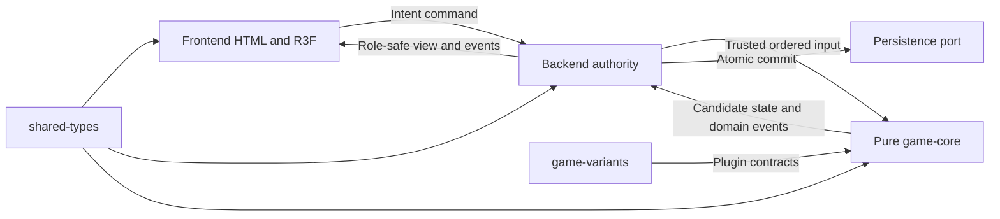

# ENGINE_ARCHITECTURE — pure deterministic core

Ngày 2026-10-13. Kiến trúc Phase 00 đã được review và cho phép triển khai nền tảng Phase 01A; ràng buộc đã xác nhận dẫn từ [gameplay](GAMEPLAY_SPEC.md). Engine gameplay vẫn chờ Phase 01B. Các quyết định nhóm Variant chưa duyệt không được enable.

## 1. Ranh giới monorepo

| Workspace | Trách nhiệm | Dependency cho phép |
|---|---|---|
| `packages/shared-types` | Domain primitives, schema serializable, command/event/view/version contracts; validation dùng cùng schema | Không phụ thuộc apps, Three/Nest hoặc game-core |
| `packages/game-core` | Reducer, validation/query, effect scheduler, transactions, RNG, snapshots, invariant checks | shared-types; không network/storage/rendering/wall-clock |
| `packages/game-variants` | Definitions và pure planners của Variant; catalog phát sinh từ definitions | game-core plugin interfaces + shared-types; không apps |
| `packages/game-testkit` | Scenario builders, deterministic fixtures, fault injection, replay corpus utilities | core, variants, shared-types; chỉ dev/test |
| `apps/backend` | Auth, room/match application service, command sequencing, clocks, persistence, projection, Socket.IO | core + variants + shared-types; testkit chỉ tests |
| `apps/frontend` | Role-safe view, HTML UI, R3F scene, input, animation/replay presentation | shared-types; không nhận full core state; optional core predictor chỉ sau leak review |

Backend composition root nạp variants qua interface core; core không import implementation variant. Frontend không dùng backend/plugin nội bộ để suy gameplay. Một bộ schemas và catalog chuẩn sinh từ manifest approved; không viết bản AP/duration riêng trong UI.

Đề xuất npm workspaces + một lockfile, TypeScript strict và scripts hiện có khi Phase 01 tạo mới; chưa cần Nx/Turbo, DI container trong core, microservices, actor framework hoặc ECS. Mỗi match có một hàng đợi serial trong một backend process; persistence CAS chống writer thứ hai. Tách process chỉ khi tải/HA yêu cầu.

## 2. Mô hình state

Full state là serializable data, không chứa callback, socket, Date, THREE object hoặc timer handle. Dùng object/array records; registry/hàm nằm trong `RulesetBundle`, không serialize function. Snapshot round-trip không alias nested metadata.

| Dữ liệu | Nội dung và invariant |
|---|---|
| Identity/version | matchId, engineVersion, rulesetVersion, stateSchemaVersion, rngAlgorithmVersion, ruleset content hash |
| Board | 225 occupancy slots tham chiếu pieceId; một quân hiện diện ở đúng một ô; vị trí khớp hai chiều |
| Pieces | id/incarnation, originalSide, owner, baseType, currentType, position/presence, movementProfile reference, effect IDs |
| Players | White/Black gameplay resource; AP, selected variant, turn policy; không credential/PII |
| Turn | sideToAct, plyIndex, roundIndex, phase, mainMoveUsed, skill slots/IDs, skillPassed, firstWhiteHardGraceUsed |
| Effects | instanceId/type/schema version/target/source/source skill/application sequence/lifecycle/payload; xem [effect spec](EFFECT_SYSTEM_SPEC.md) |
| Variant state | `byPlayer[side][variantId]`, typed definition version; không flat shared counters |
| Delayed actions | id, due logical boundary, source/cause, typed intent, cancellation/target-missing policy |
| RNG và ID | seed/state/cursor, deterministic allocation counters; RNG algorithm có version |
| History phục vụ luật | bounded position snapshots cho Time, semantic repetition map, graveyard/death records, explicit counters |
| Terminal | ongoing hoặc terminal result/reason/winner; chỉ một transition |

MatchRuntime phía backend giữ authority epoch, revision, network cursors, clocks và connectivity. Replay envelope chứa ordered runtime inputs/outcomes để có thể dựng gameplay và kết quả; runtime wall-clock measurements được persist riêng. `plyIndex/roundIndex` không thay cho revision: nhiều skill/command có thể trong cùng ply.

Phân biệt ba fingerprint: full deterministic gameplay state hash để replay/invariants; semantic repetition key theo Q-07; role-view hash để client resync. Không gửi full-state hash/seed/hidden registry payload cho live client.

## 3. Public seam

Core dự kiến có bốn thao tác thuần: create initial state từ approved ruleset/config/seed; query full legality/skill quote; resolve một trusted ordered input thành candidate state/events hoặc structured rejection; encode/decode snapshot theo version. Đây là contract mô tả, không implementation.

Root command là ý định có requester do backend gắn, không client-supplied authority. Derived intent là operation engine/plugin tạo và mang cause, quyền, consumption policy. Domain event là fact đã xảy ra, không command tùy ý người xem gửi. System input như timeout/forfeit phải được adapter xác minh deadline/authority epoch trước khi core xử lý. Rejection không phải một event gameplay committed.

## 4. Root transaction và action order

CONFIRMED P00-08: FIFO cascade; pre-death chỉ can thiệp cancel/redirect; death AP/passive chỉ sau death commit; capture King kết thúc sau interception hợp lệ và bỏ cascade còn lại. Ma trận priority chi tiết của từng effect vẫn D-04, không port `ResolutionOrder.ts` tự động.

Trình tự ĐỀ XUẤT:

1. Backend auth/seat/phase/expected revision/idempotency và deadline arbitration; chỉ một input cho match tại một thời điểm.
2. Deep clone dữ liệu cần thiết thành candidate (ban đầu clone toàn state cho đơn giản); giữ queue/events/ID/RNG mới trong transaction.
3. Core kiểm requester/current turn/controller, root schema, target geometry, hard constraints, skill availability, quote tổng actual cost. Read-only planner không nhận state mutable.
4. Ghi debit/slot/counters và enqueue typed operations trong candidate. Không planner nào thay AP hoặc board trực tiếp. Invalid target/không đủ AP không tiến RNG/ID.
5. Mỗi operation qua invariant validators của loại operation; root phase restrictions không áp máy móc vào forced operations. Capture interception, defense, movement replacement được quyết ở stage đã khai báo.
6. Reducer ghi fact, phát internal event trong candidate; dispatcher lấy listener snapshot, chạy ổn định, enqueue derived FIFO. Removal/reaction có `causeId`; handler không chạy lại cùng event-instance-reaction.
7. Sau death commit mới enqueue reward/graveyard/death passives. Capture King terminal ngừng queue theo P00-08; cleanup tối thiểu đảm bảo board/effects invariant, không chạy damage/bonus cascade còn lại.
8. End-turn/cleanup/switch/start nếu root thực sự hoàn thành turn; thời điểm counts/repetition theo decision matrix. Queue drain xong kiểm toàn invariant.
9. Backend persist input + outcome/events + revision + runtime clock state + idempotency receipt trong một DB transaction. Chỉ sau durable commit mới publish candidate và gửi ACK/view/events.

Failure trước durable commit bỏ toàn candidate, mọi AP/slot/queue/event/RNG/ID/history giữ như trước. DB unavailable không ACK success; runtime pause có ghi nhận infrastructure interruption, không làm người chơi thua do lỗi lưu. Commit thành công nhưng ACK mất: retry cùng commandId trả receipt trước, không re-execute. Commit chưa rõ do mất kết nối DB: truy hồi receipt/CAS trước retry, không phỏng đoán success.

No partial success khi queue vượt budget. Giới hạn kỹ thuật dự kiến: operation budget và listener depth configurable trong ruleset/runtime policy, phát `RESOLUTION_LIMIT` + rollback + telemetry; không coi số 500 legacy là luật. Error phải phân biệt invalid root (normal rejection), soft derived outcome được spec cho phép, và engine invariant failure (rollback). Target chết rồi hoặc explosion trùng death thường là deduplicated no-op theo contract, không exception tùy ý.

## 5. Events, deterministic ordering và plugin safety

Events mang eventId deterministic, transaction/cause, actor/controller/owner tại thời điểm fact, piece IDs, from/to, movementCause, removalReason và visibility classification. Không suy attacker bằng tìm quân ở `to`; stand-still capture không đưa attacker tới đó.

Shared effect definition/consumer được đăng ký một lần theo ruleset. Dispatcher chạy từng effect instance hợp lệ đúng một lần; owner-scoped passive chạy một lần đúng player. Listener IDs/priority là dữ liệu stable, không dựa import/object-map/subscription runtime order. Ties cần unique stable tie key trong manifest và pairwise fixture; priority số nhỏ/lớn chỉ có nghĩa sau D-04. Cancel chỉ dừng stage bị hủy; event quan sát fact đã committed không bị một defense callback xóa các hook khác.

Plugin nhận immutable query/context, trả plan operations và patch intent cho state riêng của nó. Core reducer duy nhất viết state; backend composition không cung cấp references mutable để bypass. Runtime development freeze và typecheck/lint import boundary là defense hữu ích; không hứa `readonly` TypeScript là sandbox bảo mật cho plugin không tin cậy. Plugins được review và deploy cùng ruleset, không chạy upload code của người chơi.

## 6. RNG, IDs, numbers và canonicalization

Đề xuất PRNG uint32 có algorithm version cố định + golden vector, seed sinh server bằng nguồn secure trước match, gameplay dùng stream trong core; không dùng Math.random/Date.now để resolve skill. RNG không cần cryptographic cho simulation nhưng seed/state phải kín trong live match. Nếu cần tính công bằng có commit seed và postgame reveal sau này, không tăng scope prototype.

Candidate giữ cursor; rollback không tiêu random draws. Mọi chọn random dùng candidate pool được sort canonical trước sampling và có bounded rejection algorithm được test. Replay ghi seed/algorithm/version cùng ordered inputs; random outcome domain events dùng để kiểm chứ không thay re-execution oracle. ID có counter theo match/kind, không phụ thuộc wall time, locale hoặc unordered collection. Dùng integer AP/counters/coordinates; tránh float gameplay.

Canonical codec sort keys và collections theo schema, map references thành semantic structural labels khi tính repetition; giữ object identity references trong full snapshots. Repetition gồm owner và controller, normalize absolute source deadlines thành remaining logical duration; count tại actionReady sau turnStart resolution, gồm initial position và relative delayed state, loại RNG cursor theo P00-10. Domain timers dùng logical boundaries; source anchor không lấy wall-clock. Queue scheduler sort due boundary rồi stable ID; tie behavior cần manifest case.

## 7. Rewind, rollback và replay

| Cơ chế | Phạm vi | Được phép đổi timeline? |
|---|---|---|
| Time rewind | Vị trí quân sống, P00-04; AP/effects/type/control/RNG hiện tại giữ nguyên; collision reject | Tạo action mới trong timeline; revision tăng |
| Transaction rollback | Toàn candidate kể cả RNG/ID/events/slots/history | Không có commit mới |
| Replay restore | Full snapshot theo schema + inputs sau snapshot | Dựng playback riêng, không mutate match live |

Time snapshots có snapshotId, ply/side/boundary/action sequence, không tra bằng round alone. Khoảng 2/10 ply và fallback earliest của legacy còn D-11; retention chỉ chốt sau lookback. Rewind animation từ diff/event, không phát Move cho mọi quân trừ khi D-11 cho phép triggers. Technical restore bao gồm queue trống tại commit boundary và delayed actions persisted; không serialize queue đang drain.

Replay header: initialConfig/layout, seed, engine/ruleset/schema/RNG versions, plugin manifest/hash. Record accepted ordered inputs, deterministic event sequence/hash và runtime terminal inputs. Ruleset bundle immutable được archive/dispatch bởi version; không tải latest cho replay cũ, không vô hạn hỗ trợ mọi source cũ. Upgrade midmatch bị cấm mặc định; old runtime được giữ hoặc server dừng nhận trận version cũ theo rollout plan. Không yêu cầu migrate log legacy trong clean rebuild.

## 8. Rủi ro và nghiệm thu

Risks có bằng chứng: [04 risks](../rebuild-audit/04_REBUILD_RISKS.md), [ActionPipeline](../../reference/old-project/packages/game-core/src/action/ActionPipeline.ts), [Board clone](../../reference/old-project/packages/game-core/src/board/Board.ts), [GameState](../../reference/old-project/packages/game-core/src/state/GameState.ts), [VariantRegistry](../../reference/old-project/packages/game-core/src/variant/VariantRegistry.ts), [EventBus](../../reference/old-project/packages/game-core/src/event/EventBus.ts). Đây là điều cần tránh, không source để migrate.

Acceptance: same seed/config/inputs byte-identical events và canonical state; round-trip deep snapshot độc lập; derived failure/budget/storage failure không partial commit; mirrored states/hooks/links độc lập; full legal query bằng validation; main/death/terminal invariants pass. Xem [TEST_STRATEGY](TEST_STRATEGY.md). Phase 01 chưa bắt đầu khi chỉ viết xong kiến trúc.
