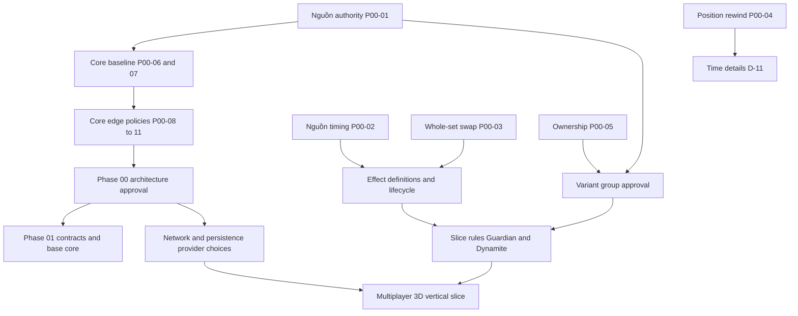

# OPEN_DECISIONS — decision tree và sổ phê duyệt

Ngày 2026-10-13. Chủ dự án quyết gameplay; architect tìm bằng chứng và đưa phương án. Recommendation chưa được trả lời **không phải** luật. Spec/architecture viết xong không tự duyệt Phase 01. Các decision IDs stable để fixtures/PR tương lai truy vết.

## Phase 02B-6 — Live Charge-only owner approvals (2026-10-16)

Owner explicitly authorizes documentation-first implementation and verification of one real experimental Live Charge producer. These six answers are **APPROVED only for Live Charge**; Guardian answers below remain intact. At authorization, implementation/enablement were pending acceptance, not inferred from approval. Parent D-04/05/06/08/12/22 remain OPEN/PARTIALLY_APPROVED outside signed subsets. No commit/push or automatic next milestone.

| Decision ID / producer subset | APPROVED answer |
|---|---|
| D-22.FIRST_PRODUCER.SCOPE / Dynamite | Explicit experimental Dynamite Live Charge-only profile; no other skill, passive, Landmine, Detonation/refund, setup bonus or initial Bomb |
| D-22.DYNAMITE.LIVE_CHARGE.PROFILE / targets | Exactly one live actor-controlled ordinary-original supported Pawn/Knight/Bishop/Rook/Queen; King, special/summoned/unknown origin excluded. Relocation permits eligible ordinary-original non-King destinations of either controller, preserving ID/source/payload/permanent lifetime; cast allegiance is not continuing validity |
| D-22.DYNAMITE.LIVE_CHARGE.PROFILE / cost | Fixed3 AP, charged once by root on successful skill commit; no discount, alternative cost, attachment reward, passive or refund |
| D-22.DYNAMITE.LIVE_CHARGE.PROFILE / duplicate cast | Any active Bomb family on target rejects the producer cast before AP/slot debit, preserving all existing data. Generic family application retains duplicate-ignore; never a paid no-op |
| D-05.FIRST_PRODUCER.SOURCE_PROFILE / Live Charge | Player-originated-v1: invoking player, exact dynamite/dynamite.live_charge, canonical null sourcePiece/null sourceIncarnation. No caster generator; original attribution stable through control/relocation/death/chains |
| D-06.FIRST_PRODUCER.REMOVAL_PROFILE / Live Charge | Permanent, no N/deadline; bearer committed-death and terminal cleanup only. No cleanse/dispel/source-invalidated/consume/replace/other removal. Committed capture/destruction still explodes; terminal cleanup never explodes |

Separate pins/authorization, trusted piece-target-v1 planning, reviewed Bomb registration, real exported-API acceptance, rollback/codec/replay and Standards/Spec reviews are technical acceptance gates. No Mine producer, hidden state, new priority matrix, source graph normalization, full Dynamite or Phase03 is authorized.

**02B-6 delivery:** Live Charge IMPLEMENTED / READY / ENABLED only for selected players through `createLiveChargeExperimentalRuleset`, profile `dynamite.live-charge-only.experimental` v1.0.0. Existing Holy Shield factory remains unchanged. Engine0.6.0/state1.1.0 retained; root611 tests/33 files PASS (+58), required engine checks PASS. Milestone **READY_WITH_CONDITIONS** solely because `smoke:runtime` HTTP loopback is environment-blocked EACCES, not claimed PASS. Standards1 harness finding fixed with red/green regression; Spec0. No new gameplay approval or parent closure implied. Evidence: [02B-6 report](PHASE_02B_6_LIVE_CHARGE_REPORT.md).

## Phase 02B-5C — implementation authorization (2026-10-16)

Owner authorizes only the real experimental Guardian Holy Shield producer, using the six approved answers below unchanged. Implement authoritative player/profile binding, versioned single-piece target intent, pure trusted planner, fixed4 AP/one skill slot, complete Shield registration and focused/root/replay/security acceptance. Ordinary-original provenance must be explicit; unknown/special/summoned units fail closed. Public seams are root commands, pinned ruleset/plugin, queries, effect records and snapshot/repetition/replay. No full Guardian, other abilities, transport or subsequent milestone. No commit/push. At authorization time enablement was pending; the acceptance entry below records the final implementation status and exact pins. Parent decisions remain open for unrelated producers/interactions. No new gameplay approval recorded.

**Implementation acceptance5C:** PASS, engine0.6.0/state1.1.0, root549/29 and required checks PASS, independent reviews0 findings. Holy Shield is READY/ENABLED only in the pinned experimental factory for explicitly selected players; other skills/producers remain disabled. This records implementation acceptance of existing approvals, not new gameplay answers or closure of parent decisions. Evidence: [5C report](PHASE_02B_5C_REPORT.md). No next milestone authorized.

## Phase 02B-5B — approved limited Holy Shield profile (2026-10-15)

Owner authorizes **bounded null-caster source normalization only**, not 5C/playable Holy Shield. Record these six answers before implementation. Public registry/instance validation, root consumer operations, repetition, snapshot and replay are the authorized test seams. All real producers remain **ENABLED=false / NOT_READY** until separately implemented/accepted.

| Decision | APPROVED exact Holy Shield-only answer |
|---|---|
| D-22.FIRST_PRODUCER.SCOPE | Experimental limited Guardian may contain Holy Shield only; Sanctuary, Divine Shield, Holy Aura and other passives unavailable; never label complete Guardian |
| D-22.GUARDIAN.HOLY_SHIELD.TARGETS | Cast exactly one invoking-player-controlled ordinary supported piece, King included; no special/summoned units. Eligible relocation to either controller's ordinary pieces including King preserves ID/source/payload/deadline. Cast allegiance is not continuing validity after controller change |
| D-22.GUARDIAN.HOLY_SHIELD.DURATION | N2 source-end rounds, no cast tick; same-source reset2/stable ID, independent cross-source Shields |
| D-22.GUARDIAN.HOLY_SHIELD.COST_PROFILE | Fixed4 AP only; no Holy Aura discount, graveyard threshold, alternate cost or death inventory |
| D-05.FIRST_PRODUCER.SOURCE_PROFILE | Holy Shield is player-originated: required player, exact variant `guardian`, skill `guardian.holy_shield`; canonical sourcePiece=null/sourceIncarnation=null; no caster/liveness/incarnation producer |
| D-06.FIRST_PRODUCER.REMOVAL_PROFILE | Limited profile enables only natural expiry, bearer-death cleanup and terminal cleanup. No cleanse/dispel/source-invalidated removal or custom removal reactions; original source stable |

The source/removal/scope answers do **not** approve Sanctuary, Live Charge, Landmine or full Guardian/Dynamite. Parent D-04/05/06/08/12/22 remain OPEN/PARTIALLY_APPROVED. New opt-in validation may reject attempts to use non-null refs or other source IDs with the null-only declaration; old synthetic definitions do not become reviewed production source graphs. Existing exact runtime matching/attribution and projector key structure must remain intact. No producer registration, target planner/command payload, actor→Variant authorization, cost debit, lineage/graph solver, backend/frontend, dependencies, 5C or commit/push.

## Historical Phase 02B-5A — first producer approval preparation (2026-10-15)

**Authorized: DOCUMENTATION ONLY.** 02B-4 consumer foundation READY_WITH_CONDITIONS, engine0.5.0 /447 tests/27 files là baseline báo cáo trước; all concrete producers **ENABLED=false / NOT_READY**. 5A không approve gameplay fields mới, code, versions hoặc 5B/5C. Current questions/options/provenance tại [First producer matrix](FIRST_PRODUCER_APPROVAL_MATRIX.md) §8; technical gate riêng tại [Source repetition plan](SOURCE_REPETITION_NORMALIZATION_PLAN.md). Scope/numeric/source/category/family/clock rules đã chốt giữ nguyên, không hỏi lại.

| Outstanding child decision ID | Exact dependent field / gate | Status |
|---|---|---|
| D-22.FIRST_PRODUCER.SCOPE | Limited Holy Shield experimental Guardian only; other Variant subset approval separate | APPROVED Holy Shield only; others OPEN |
| D-22.GUARDIAN.HOLY_SHIELD.TARGETS | Cast one controlled ordinary piece including King; eligible ordinary either-player relocation | APPROVED Holy Shield only |
| D-22.GUARDIAN.HOLY_SHIELD.DURATION | N2/source-end/no cast tick | APPROVED Holy Shield only |
| D-22.GUARDIAN.HOLY_SHIELD.COST_PROFILE | Fixed4; no passive/discount/graveyard | APPROVED Holy Shield only |
| D-05.FIRST_PRODUCER.SOURCE_PROFILE | Holy Shield exact guardian/guardian.holy_shield/null/null; other producer refs unresolved | APPROVED Holy Shield only; others OPEN |
| D-06.FIRST_PRODUCER.REMOVAL_PROFILE | Holy Shield expiry/death/terminal only; other permissions/region dependencies unresolved | APPROVED Holy Shield only; others OPEN |
| D-22.GUARDIAN.SANCTUARY.REGION_PROFILE | Center/geometry/outer category/removal/cost; confirmed3/1 unchanged | OPEN / UNKNOWN |
| D-08.GUARDIAN.SANCTUARY.TRIGGER_PROFILE | Committed capture/victim/attacker/death-cell eligibility, King/special-unit profile | OPEN / UNKNOWN |
| D-05.GUARDIAN.SANCTUARY.REGION_RECAST | Outer same-center/different-center behavior and overlap application/fact multiplicity; generated Stun matching unchanged | OPEN / UNKNOWN |
| D-22.DYNAMITE.LIVE_CHARGE.PROFILE | Target/King/special units/cost and producer cast validity on an existing Bomb; family ignore unchanged | OPEN / UNKNOWN |

The six Holy Shield answers in the current 5B table supersede the historical options/questions in 5A. Other index entries remain questions, not approved rules. D-12/D-25/D-22 Landmine placement/entry/consume/reveal/setup/refund remain DEFERRED; parent decisions stay OPEN/PARTIALLY_APPROVED. Structured source identity/categories and P00-02/03/05/08/09/10/11, Sanctuary3/Stun1/Chains3 are not reopened by older wording below.

Engineering gates, not owner gameplay questions: E-PRODUCER (actor-authorized target intent/plan), E-SOURCE-PROJECTION (profile-owned semantic source normalization, proposed 5B), optional E-COST-LEDGER/E-INCARNATION and later E-SANCTUARY. Passing any technical gate enables no producer without its signed profile and separately authorized implementation/acceptance.

## Quyết định đã chốt trong phiên Phase 00

Các câu trả lời trực tiếp ngày2026-10-13 là nguồn xác nhận mới; chỉ cập nhật tài liệu rebuild, giữ nguyên nhật ký legacy.

| ID | Câu hỏi / quyết định CONFIRMED | Phạm vi |
|---|---|---|
| P00-01 | Nguồn luật: GDD/catalog chưa duyệt giữ là ứng viên, duyệt theo nhóm Variant; không lấy source legacy làm luật mặc định | Toàn bộ spec; Q/O đã chốt tiếp tục có hiệu lực |
| P00-02 | Duration N round hết cùng start/end boundary của lượt source sau N round; không tick lúc cast | Effect clock generic; custom progress/counters cần declared policy riêng |
| P00-03 | Turtle swap toàn bộ effect sets giữa hai quân, giữ source/expiry; reject toàn thao tác nếu bất kỳ effect/link/target chưa hợp lệ | Generic whole-set relocation; scope hai pieces, không tự mở rộng cells/players |
| P00-04 | Time rewind chỉ vị trí quân sống trong snapshot; giữ AP/effect/type/controller/RNG; không revive/xóa summon; collision reject atomic | Rewind/Grand Rewind; lookback/window/triggers còn D-11 |
| P00-05 | Loss AP owner hiện tại; capture/promotion AP controller thực hiện; control không đổi owner, conversion explicit đổi owner | Game identity và economy; không tái hỏi Q-17 |
| P00-06 | Duyệt back rank R N B R N B Q K Q B N R B N R,30/bên; Pawn 1/2/bắt chéo, Bishop chéo+ngang1, quân khác GDD, không castling/en passant; Queen promotion +3; capture AP 2/3/3/4/5,loss AP 1/2/2/3/4; AP 0/no cap | Baseline B-01/02/03 và D-01 đã resolved; orientation Q-06 |
| P00-07 | Duyệt đúng 1 main move/tối đa 1 skill; skill trước/sau; Move xong giữ cửa sổ skill/End; auto-end khi đã đủ move+skill, không vì thiếu skill khả dụng | Baseline B-04/D-02 resolved; Cherubim/repeatable còn group gate |
| P00-08 | FIFO cascade, handler stable order; pre-death chỉ cancel/redirect; AP/death passive sau death committed; capture King terminal sau interception hợp lệ và bỏ remaining cascade | D-04 partial resolved; priorities per-effect và Phoenix chưa duyệt |
| P00-09 | Server xác nhận không có main move hợp lệ thì cho End forced skip; vẫn có thể skill mở đường trước | D-03 resolved; không thêm stalemate/checkmate |
| P00-10 | Threefold count tại turnStart sau hooks/effects/delayed resolution, gồm initial position; không thêm RNG cursor vào key; relative delayed deadlines trong semantic variant state | D-09 resolved; canonical IDs/graph labeling là technical design |
| P00-11 | Cleanse/dispel cleanup mặc định; chỉ hậu quả riêng được approved mới chạy. Swap relocation không expire/on-apply/reward | D-06 phần common lifecycle resolved; per-effect exceptions chờ nhóm |
| P00-12 | AP không decay theo lượt/round; King có capture/loss AP=0, capture King không thưởng AP | D-29 resolved; bổ sung baseline economy/terminal |

Luật Q/O đã resolved trong [06 decisions](../audit/06-decisions.md) không mở lại: mirror; orientation; AP destroy; Time modes; King normal effects/restrictions và non-capture protection; Guardian3/1; Nephalem3; Zombie free3 round; Predator Pawn range; Puppet7=2+5; Ghost second obstacle; Devil repeated sacrifice; Space/Verdant; auth/clocks/disconnect/retention/version. [08 diff](../audit/08-variant-diff.md) có wording mở cũ nhưng phần cuối đã chốt O-7/8/9.

## Phase 02B Batch A — approved rules freeze, 2026-10-15

### Phase 02B-3 authorization — Bomb consumer foundation

Owner authorizes bounded Bomb charge/mine consumer foundation from approved D-12.BOMB / D-05.BATCH-A.BOMB / D-12.BOMB.ATTRIBUTION / D-06.BOMB.CATEGORY: permanent public unlinked piece attachments, family-wide unique-target duplicate ignore, committed capture/destruction death snapshot, actual death-center 3×3/non-King blast, original per-Bomb source and FIFO chain/death dedup. Shield-canceled capture/cleanup/relocation/swap do not explode; King capture terminal stops remaining queue. Family uniqueness must validate import/final relocation assignment. Technical schemas/mode/version pin and tests may proceed; complete producer King/targets/refs/removal/cost profiles remain UNKNOWN. No Dynamite/Live Charge/Landmine/hidden cell/other death causes/02B-4/Phase03 or commit/push. Parent D-04/05/06/08 and unrelated fields remain OPEN/PARTIALLY_APPROVED.

### Phase 02B-1 authorization và supplemental approvals — 2026-10-15

**Subsequent authorization — Phase 02B-2 Shield Foundation:** owner explicitly authorizes isolated capture-defense adapter, shared authoritative query/root checks, timed structured-source integration, disabled Shield descriptor/schema and regression verification. Approved Shield rules below unchanged: atomic root rejection/no consumption/no rewards; not destruction protection. Complete producer N/target/King/required refs/removal permissions remain UNKNOWN and block enablement. No Guardian/Bomb/02B-3. Arbitrary Shield×interceptor pairs retain explicit unsupported gate; this is a technical fail-closed boundary, not approval of a priority matrix. Record completion separately in PHASE_02B_2_REPORT.

Chủ dự án cho phép **Stun Foundation**: source-aware opt-in matching, validated producer N, consistent main legality/forced End/capture threat, disabled concrete Stun boundary, codec/repetition/replay và tests. Cập nhật docs trước code; không Shield/Bomb adapter, Variant skills, live Stun manifest, 02B-2 hoặc commit/push. Milestone có thể PASS foundation trong khi producer enablement vẫn NOT_READY.

- **D-05.BATCH-A.SOURCE_IDENTITY APPROVED:** Stun/Shield dùng immutable tuple sourcePlayer +sourceVariant +sourceSkill +caster piece khi có +caster incarnation khi supported bởi producer. Optional refs canonical; không fake incarnation; không current owner/controller/caster position/live lookup hoặc player-only nếu refs khác. Tuple capture tại creation, giữ qua caster movement/death theo lifecycle/control/relocation/swap; chỉ explicit approved source replacement mới đổi. Existing synthetic policies không tự chuyển sang mode mới.
- **D-06.STUN.CATEGORY APPROVED:** `effect.stun` DEBUFF.
- **D-06.SHIELD.CATEGORY APPROVED:** `effect.shield` BUFF. Bomb charge BUFF/mine DEBUFF giữ nguyên; không áp cho effect khác.

Source identity/categories không còn questions cần hỏi lại. N/King/targets/removal/acting-piece producer permissions vẫn UNKNOWN trừ fields prior approved; O-8 Stun1/O-9 Chains3 chỉ numeric evidence cho contract tests, không enable producers. Empty immutable Stun payload được phép nếu không mang gameplay behavior mới. Các parent D-04/05/06/08/12 vẫn OPEN/PARTIALLY_APPROVED; không full defense/threat approval.

Authority: prompt chủ dự án **APPROVED BATCH A RULES FREEZE**, cao hơn proposals 02B-0 và legacy. Milestone này **DOCS ONLY**, không authorization 02B-1/enable concrete ruleset. Manifest chi tiết: [Batch A approved manifest](PHASE_02B_BATCH_A_APPROVED_MANIFEST.md); gate: [implementation plan](PHASE_02B_IMPLEMENTATION_PLAN.md).

**10 decision IDs được APPROVED trong đúng subset sau; parent D-04/05/06/08/12 vẫn OPEN/PARTIALLY_APPROVED.** Không đóng toàn parent hoặc approve interaction ngoài Batch A.

| Subset ID | Approved behavior | Giới hạn còn OPEN |
|---|---|---|
| D-05.BATCH-A.STUN | Same family/type + same source identity + same target refresh/reset bằng new approved N, giữ instance ID/source clock; tối đa một instance/key. Cross-source instances độc lập; active ≥1 thì Stun; không overwrite nguồn khác | Exact source-identity tuple và non-lifetime refresh payload policy chưa được nêu; không tự đồng nhất source identity với chỉ player |
| D-06.STUN | Cấm main Move/Capture bởi bearer; không tự cấm forced displacement/teleport/reposition, skill targeting hoặc mọi skill dùng piece; không đổi owner/controller/AP | Acting-piece skill restrictions theo producer chưa duyệt |
| D-08.STUN | Bearer có active valid Stun không góp capture threat; query/consumers nhất quán | Không đóng Ghost/Bind/terrain/other movement threat semantics |
| D-05.BATCH-A.SHIELD | Same-source/same-target refresh/reset new approved N, giữ ID; different sources độc lập, boolean protection, không charges hoặc merge clocks | Exact source identity/non-lifetime payload policy; other effects không thừa hưởng |
| D-06.SHIELD | Time-based capture protection; không chặn destruction/AoE/sacrifice bằng Shield; không consumption/debit khi block | Concrete removal permissions/producer eligibility vẫn chưa đủ |
| D-04.SHIELD | Blocked attempt reject atomic: no main-slot/AP/RNG debit, no committed capture/death/AP reward/Bomb reaction/King terminal; no accepted blocked-mutation outcome | Isolated subset only; Shield×redirect/Fate/Phoenix/Aegis/full defense priority vẫn OPEN |
| D-12.BOMB | Bearer committed capture/destruction death → blast death-position thật, 3×3 clipped board, mọi non-King hai phe/capturer nếu ở vùng khi resolution; protected King, FIFO/death dedup/terminal stop; destroy không capture AP, loss AP owner | Producer target/King eligibility chưa duyệt; không suy sacrifice/despawn/exile là triggering cause; cleanup/expiry không trigger |
| D-05.BATCH-A.BOMB | Tối đa một active family `bomb`/target trên cả charge/mine và mọi sources; duplicate ignore, không refresh/replace, giữ original source/payload/lifetime, không thêm explosion instances | Family adapter cần nếu matching hiện chỉ definition ID; không approve family policy cho effect khác |
| D-12.BOMB.ATTRIBUTION | Blast attribution original Bomb source, không root actor/capturer; giữ khi relocate/swap; AP vẫn luật capture/loss đã duyệt | Không tự thêm producer-specific AP reward |
| D-06.BOMB.CATEGORY | `effect.bomb.charge` BUFF; `effect.bomb.mine` DEBUFF; cùng family `bomb`, shared pure blast consumer; versioned schemas độc lập, chung uniqueness | Aegis/Blessing/cleanse-category interaction và schema version/payload cụ thể chưa freeze |

**6 metadata groups được APPROVED**, đặt labels truy vết `BATCH-A.META.*` cho các mục trực tiếp trong prompt (không phải thêm approval ngoài prompt):

| Label | Approved fields | Unknown/deferred boundary |
|---|---|---|
| BATCH-A.META.SOURCE_TIME | Source-player ownership/attribution; Stun/Shield source-end, N từ approved producer, không cast-boundary tick, same-source reset new N/new anchor; Bomb permanent | Không tự chọn N chưa duyệt hoặc source-identity tuple |
| BATCH-A.META.VISIBILITY | Stun/Shield/Bomb charge/Bomb mine đều public **attachments** | Hidden cell Landmine chưa reveal/approve bởi quyết định attachment này |
| BATCH-A.META.LINKS | Bốn Batch A definitions unlinked, không partner/group refs tự tạo | Không áp unlinked cho effect khác |
| BATCH-A.META.RELOCATION | Generic piece relocation/whole-set swap giữa eligible targets; giữ source/ID/payload/deadline, không onApply/onExpire; revalidate concrete destination, invalid → whole swap reject | Không approve Turtle skill targets/cost/empty-set gameplay |
| BATCH-A.META.ELIGIBILITY | Không global King immunity; concrete definition +producer quyết eligibility; Bomb blast không destroy King | King attachments, producer target restrictions và special units phải được approved subset trước enable; không blanket non-King hoặc allow-King |
| BATCH-A.META.REMOVAL | Giữ P00-11 cleanup-only cleanse/dispel, không tự natural-expiry/death rewards | Concrete removal permissions/exceptions và source-piece invalidation vẫn UNKNOWN |

**Remaining freeze questions**, không mở lại behavior đã duyệt: (1) matching source identity gồm player thôi hay thêm variant/skill/piece/incarnation; (2) Stun/Shield categories chưa được prompt định danh như Bomb; (3) non-lifetime payload refresh nếu producer mang gameplay payload; (4) allowed producers, exact N/targets/King/removal permissions. Field kỹ thuật schema/payload rỗng có thể thiết kế sau authorization; không tự điền gameplay-bearing fields. Chi tiết mức block tại manifest/plan. Các unknown này không buộc approve 27 Variants trước xây reusable foundation.

## Quyết định milestone 01B-1 — 2026-10-14

- **B1-01 CONFIRMED:** friendly/enemy capture targets được xác định bằng so sánh controller của attacker và target. Owner/originalSide giữ riêng; Pawn lấy hướng từ controller theo Q-17. Chủ dự án chọn phương án này trực tiếp trong phiên 01B-1.
- Chủ dự án chỉ cho phép Board/Piece/coordinates/pure movement, tests và verification. Không tự chuyển sang 01B-2; AP/turn/transaction/effects/Variant và backend/frontend gameplay ngoài scope.

## Clarification milestone 01B-2 — P00-06 giữ nguyên

- **B2-01 CONFIRMED:** chủ dự án xác nhận Piece Loss AP Reward/Loss AP Gain là khoản **cộng** cho owner hiện tại: Pawn +1, Knight/Bishop +2, Rook +3, Queen +4, King +0. Capture reward thuộc controller của attacker; capture King không thưởng AP cho bất kỳ bên nào. Đây là clarification P00-06, **không đổi luật gameplay**.
- Theo P00-08, chỉ settle reward sau committed death/destruction; candidate hoặc canceled capture không có reward. Despawn/exile/transformation không tự được coi là death; các removal causes chưa approved giữ pending.
- Chủ dự án duyệt duy nhất 01B-2 (AP/normal turn/King terminal/Queen promotion, pure domain operations/tests/verification), giữ contracts 01B-1, không bắt đầu 01B-3. Negative AP/Pirate debt vẫn chưa approved cho baseline.

## Phê duyệt hoàn thành 01B — milestones 3/4/5

Chủ dự án đã cho phép triển khai liên tiếp 01B-3 → 01B-4 → 01B-5, chuyển bước khi acceptance pass và report đã ghi. Giữ mọi luật CONFIRMED; không concrete Variant/full Effect Engine/network/storage/UI, không bắt đầu Phase 02, không commit/push. Đây là cập nhật scope/gate, không phê duyệt các quyết định gameplay còn UNKNOWN. Kết quả cuối xem [Phase 01B report](PHASE_01B_REPORT.md).

## Phê duyệt Phase 02A-1 — 2026-10-14

Chủ dự án cho phép **Effect Data Foundation**: typed definition/instance contracts, versioned payload validation, immutable deterministic registry scoped theo RulesetBundle, source/target/lifetime/group/policy metadata và codec integration tối thiểu. Không concrete effects, scheduler, triggers, stacking/relocation operations hoặc thay đổi transaction pipeline; giữ `UNSUPPORTED_RUNTIME`. D-04/05/06/08 và các group approvals vẫn pending. Hoàn thành verification/report thì dừng, không tự bắt đầu 02A-2/02B; không commit/push. Đây là phê duyệt scope kỹ thuật, không thêm luật gameplay.

## Decision tree và frontier

### Phê duyệt Phase 02A-4 — 2026-10-15

Chủ dự án cho phép generic trigger dispatch và deterministic delayed actions, tích hợp cùng root FIFO transaction, validation/replay/repetition và final verification/report 02A. Chỉ synthetic explicitly bound observers/executors; proposed/pre-death effect hooks, concrete priorities/rewards và D-04/05/06/08 chưa được duyệt tiếp tục fail closed. Không concrete effects, hidden projection, Phase 02B hoặc commit/push. Đây là scope kỹ thuật, không thêm luật gameplay.

### Phê duyệt Phase 02A-3 — 2026-10-15

Chủ dự án cho phép generic relocation và whole-set swap qua trusted derived operations, final-assignment preflight, typed reference integrity, declared group validators/semantic normalizers và internal facts. Giữ identity/source/lifetime/payload/references, không remove+apply/reward. Synthetic policies chỉ xác minh kỹ thuật; D-10/Turtle targets và concrete linked-group gameplay chưa duyệt. Thiếu relocation/graph binding thì fail closed. Không trigger execution, delayed actions hoặc group reaction cascades; dừng trước 02A-4/02B, không commit/push.

### Phê duyệt Phase 02A-2 — 2026-10-15

Chủ dự án cho phép riêng generic effect runtime: apply/matching/independent/ignore/replace/refresh/stack-instances, cleanup-only removal, source-relative expiry scheduler, typed internal facts và atomic root integration. Synthetic definitions khai báo rõ policy; đây không phải duyệt D-04/05/06/08 hoặc concrete effects. Refresh source/payload/deadline là lựa chọn per-definition, không universal default. Không whole-set swap/relocation, linked cascades, Variant triggers, delayed executor hoặc full graph normalization. Runtime chỉ opt-in theo bundle, unsupported capabilities vẫn fail closed. Hoàn thành report/verification thì dừng trước 02A-3/02B; không commit/push.

Ngày 2026-10-13, chủ dự án đã review Phase 00 và cho phép Phase 01A: monorepo foundation theo prompt hiện tại. Chưa duyệt Phase 01B hoặc gameplay implementation. Các quyết định gameplay P00/Q/O không thay đổi; việc còn mở ở nhóm Variant vẫn giữ gate riêng.

Frontier hiện tại: hoàn thành và review Phase 01A; Phase 01B cần phê duyệt riêng. Câu hỏi nhóm effect/slice chốt trước Phase 02/04; nhóm Variant sau mở khi vào phase tương ứng. Mỗi nhánh đã có câu hỏi/alternatives/impact dưới đây; Phase 01A không tự phê duyệt luật Variant còn mở.

## Câu hỏi đã resolved ở core

| ID | Kết quả | Nguồn và case |
|---|---|---|
| D-01 | RESOLVED P00-06 | [GDD STEP2/4](../GDD.md), [initialLayout](../../reference/old-project/packages/game-core/src/pieces/initialLayout.ts); exact60pieces/layout/AP |
| D-02 | RESOLVED P00-07 | [GDD turn](../GDD.md) vs legacy auto-end; Move có AP0 vẫn được End chủ động |
| D-03 | RESOLVED P00-09 | Không có legal main move → player skill trước hoặc End forced skip server-verified |
| D-09 | RESOLVED P00-10 | Q-07 key unchanged; chỉ occurrence khi actionReady của new turn, không đếm mỗi queue operation |

## Frontier effect và resolution — cần trước nhóm sử dụng

### D-29 — AP decay và King reward

❓ Q12: Giữ AP không tự decay và King AP=0, capture King không thưởng AP như GDD không?

A: giữ cả hai; B: no-decay nhưng King có reward riêng; C: chưa duyệt. **RESOLVED P00-12:** chủ dự án chọn A ngày 2026-10-13. AP không tự giảm, King reward0 và capture King không thưởng AP. Impact: resource boundary updates/terminal reward ordering; Phase 01 economy đã đủ quyết định baseline. Nguồn [GDD STEP 2](../GDD.md), [ActionPipeline](../../reference/old-project/packages/game-core/src/action/ActionPipeline.ts), CAPTURE_AP/LOSS_AP.

### D-04 — Priority matrix và capture interception

**OPEN — PARTIALLY_APPROVED:** D-04.SHIELD chỉ đóng isolated time-only atomic-cancel subset ở bảng Batch A. Các priority options dưới đây vẫn là proposals cho redirect/Fate/Phoenix/Aegis, không toàn matrix đã duyệt.

❓ Q: Nếu Shield, Puppet redirect, Fate và Bomb cùng liên quan capture, effect nào thấy proposed capture và effect nào thấy committed death? King capture bị Phoenix Rebirth chặn có được phép không?

Phương án A: Shield eligibility trước redirect, revalidate redirected capture, death committed mới Fate/Bomb/AP; Phoenix riêng chờ D-22. B: redirect trước Shield. C: lấy thứ tự legacy. ➡️ Khuyến nghị A làm ứng viên priority matrix; FIFO/committed-death/immediate King terminal đã CONFIRMED P00-08, không hỏi lại.

Impact: pre-capture stage, cancellation scope, redirected target defense và queue fixtures. Gate: Phase 02 priority contract; từng pair approval trước enable. Nguồn [ResolutionOrder](../../reference/old-project/packages/game-core/src/event/ResolutionOrder.ts), [pipeline](../../reference/old-project/packages/game-core/src/action/ActionPipeline.ts), [risks](../rebuild-audit/04_REBUILD_RISKS.md). Legacy portal interception không đi hoàn toàn qua event priority nên không đủ để chọn C.

### D-05 — Stacking/refresh/source attribution

**OPEN — PARTIALLY_APPROVED:** D-05.BATCH-A.STUN/SHIELD/BOMB đã trả lời coexistence/reset/ignore riêng từng family ở bảng Batch A. Câu Stun cross-source dưới đây là historical question đã được trả lời cho Batch A; Silence và policies khác vẫn OPEN, exact source-identity key chưa freeze.

❓ Q: Black đặt Stun lên quân đã Stun từ White: refresh giữ nguồn White, thay nguồn Black hay có hai instances? Silence cũ blockUltimate=true được Lord refresh blockUltimate=false thì sao?

A: type+source+target độc lập, chỉ merge cùng source theo policy. B: type+target, refresh thay source/payload. C: type+target giữ source/payload cũ. ➡️ Khuyến nghị A cho source-dependent effects, B cho mutually exclusive status khi có explicit arbitration; duyệt per-definition, không universal default.

Impact: stacking key, passive attribution, timer anchor và Turtle swap eligibility; gate: Phase 02 definitions. Nguồn [EffectRegistry](../../reference/old-project/packages/game-core/src/effect/EffectRegistry.ts), catalog Lord/Puppet/Phantom. Nói “refresh” chưa đủ để enable effect.

### D-06 — Per-effect removal và hard constraints

**OPEN — PARTIALLY_APPROVED:** D-06.STUN, D-06.SHIELD, D-06.BOMB.CATEGORY và Batch A metadata đã chốt subset ở trên. Stun không tự chặn forced movement; Shield capture-only/time-only đã được duyệt. Aegis, source-specific chains, removal permissions/exceptions ngoài approved subset còn OPEN.

Common policy đã CONFIRMED P00-11. ❓ Q: Sailing/Totem/control/channel/linked swap khi cleanse có fired action, Bind hậu control, return partner hoặc despawn không? Stun có cấm forced movement; Shield chỉ capture, Aegis chỉ debuff hay chặn swap relocation?

A: cleanup-only default, mỗi reason/outcome riêng theo effect; unit lifetime riêng không cleanseable. B: cleanse như natural expiry cho các effect legacy. ➡️ Khuyến nghị A. Target destruction chỉ cleanup nhóm trừ declared death reaction; không thưởng trước committed death.

Impact: removalReason matrix, forced action validator, lifecycle record tách timer buff; gate: Phase 02 và nhóm có exceptions. Nguồn [handlers](../../reference/old-project/packages/game-core/src/effect/handlers), [Effect](../Effect.md), [catalog](../Variants.md).

### D-07 — Terrain và clock increment

❓ Q: Giữ Terrain3giây auto-skip/disable skills thế nào với chess15phút+hard15giây đã chốt? Giữ +5giây khi clock<60giây không?

A: Terrain deadline3giây là exception skip được duyệt, chess clock luôn debit; hard15giây vẫn bound; không +5 increment. B: không Terrain override, chỉ effect/skill disable. C: giữ cả increment và Terrain special clock. ➡️ Khuyến nghị A nếu duyệt Lightning, bỏ low-time increment chưa có product rationale. Không kế thừa pause chess clock legacy.

Impact: deadline arbitration, timeout input kind, first White exemption vs Terrain, force-skip slot; gate: Phase 03 generic timers không phụ thuộc Terrain, Phase 05 Lightning phải chốt. Nguồn [TurnClock](../../reference/old-project/packages/game-core/src/match/TurnClock.ts), [Match](../../reference/old-project/packages/game-core/src/match/Match.ts), catalog Lightning.

### D-08 — Threat query, hard blockers và path

**OPEN — PARTIALLY_APPROVED:** D-08.STUN đã chốt không contribution capture threat của bearer Stun, query/consumer phải nhất quán. Geometry/profile/path rules, Ghost/Bind/terrain và các consumers khác trong các options sau chưa được duyệt toàn bộ.

❓ Q: Devil Eye/Wizard/Phoenix/Predator dùng hình học attack hay action legality gồm Stun/Bind/Ghost/profile? Knight jump “đi qua portal” không? Ghost có xuyên Flame/Outworld/Mountain và còn Bishop ngang1 không?

A: threat là capture geometry+movement/profile/path restrictions, không turn/AP/slot; Stun cấm attack theo definition, Ghost không xuyên terrain hard blockers, giữ Bishop ngang1. B: base geometry only như nhiều legacy queries. C: full root action legality. ➡️ Khuyến nghị A; jump chỉ có landing trừ path policy riêng Space D-19.

Impact: query context/stages, target consistency, threat passives/perft fixtures; gate: Phase 02 query seam, nhóm target-based trước enable. Nguồn [AttackDetection](../../reference/old-project/packages/game-core/src/combat/AttackDetection.ts), [MoveGenerator](../../reference/old-project/packages/game-core/src/movement/MoveGenerator.ts), [risks](../rebuild-audit/04_REBUILD_RISKS.md).

## Câu hỏi của chín Variant đặc biệt

### D-10 — Turtle target restrictions và relocation exceptions

**OPEN:** Batch A attachment relocation đã approved qua BATCH-A.META.RELOCATION, không đóng target/cost/empty-set-specific gameplay của Turtle skill.

Whole-set swap/source/expiry/atomic đã CONFIRMED P00-03. ❓ Q: Hai target có thể bất kỳ phe/King, empty sets có hợp lệ, Aegis chặn effect debuff swap vào không? Linked/control/timer effect group nào được retarget?

A: hai non-King bất kỳ phe; không cả hai empty; kiểm eligibility/Aegis trên assignment cuối; linked/control cần handler đã approved, thiếu thì reject. B: giữ ally→enemy/enemy→ally theo buff/debuff nhưng swap toàn bộ. C: any piece kể cả King nếu tất cả effects eligible. ➡️ Khuyến nghị A như ứng viên restrictions, O-6 riêng catalog non-King phải giữ cho skill vốn có restriction; cần xác định restriction swap mới rõ trước enable.

Impact: target schema, group-aware relocation, UI selection. Gate: Phase 05 Turtle (effect API Phase 02 vẫn được thiết kế theo P00-03). Nguồn [Turtle](../../reference/old-project/packages/game-core/src/variant/variants/TurtleVariant.ts), [06 decisions O-6](../audit/06-decisions.md).

### D-11 — Time lookback, missing history, triggers và Freeze

Scope position-only/collision đã CONFIRMED P00-04; modes O-7. ❓ Q: Rewind2ply/Grand10ply hay2/10 round? Thiếu lịch sử reject hay earliest? Rewind có trigger trap/prediction/portal? Giữ Future Prediction5 AP/Stun 4 round, Freeze6 round và shared ultimate cost6/9/15 không?

A: 2/10ply snapshots, reject nếu không đủ; rewind là relocation không Move/trap; giữ legacy numeric skills làm ứng viên có source-clock đã chốt; shared counter mỗi player. B: 2/10 round; fallback earliest. C: 2/10ply +earliest fallback và trigger như moves. ➡️ Khuyến nghị A, nhưng numeric/window/mode targeting phải được duyệt từng field; cast không useful không tự đốt AP.

Impact: snapshot retention/boundary, relocation causes, prediction matches actor ID kể cả stand-still capture, mirror Freeze instances. Gate: Phase 05 Time. Nguồn [Time](../../reference/old-project/packages/game-core/src/variant/variants/TimeVariant.ts), [TimeFreeze](../../reference/old-project/packages/game-core/src/effect/handlers/TimeFreezeHandler.ts).

### D-12 — Trap entry, Dynamite chain và Thunder payload

**OPEN — PARTIALLY_APPROVED:** D-12.BOMB/D-12.BOMB.ATTRIBUTION chốt blast/death-source subset ở bảng Batch A. Bomb attachment King eligibility theo producer vẫn UNKNOWN; King terminal stop đã CONFIRMED, không hỏi lại. Trap causes/consume/reveal/Thunder reward/electric duration vẫn OPEN.

❓ Q: Move/capture/push/teleport/forced move/rewind loại nào kích bẫy? Lightning trap thưởng2AP nhưng Fang trap cũng thưởng không? Scale electric1 hay2 round? Bomb trên King hợp lệ không và có kích nổ khi capture King?

A: mọi committed entry trừ rewind/swap; capture đứng yên không entry attacker; trap payload thưởng riêng producer, Fang không +2; Scale1round theo catalog description; Bomb King theo O-6 eligibility, terminal King bỏ chain theo P00-08. B: chỉ Move/Capture như phần legacy; electric2 round; chung reward. ➡️ Khuyến nghị A; không hỏi lại normal-moveset Fang/3×10/King protection đã chốt.

Impact: MovementCause taxonomy, independent shared consumer, trap consume dù Aegis/King immune? cần định từng producer; death dedup. Gate: Phase 04 Dynamite trap; Phase 05 Thunder/Lightning. Nguồn [Dynamite](../../reference/old-project/packages/game-core/src/variant/variants/DynamiteVariant.ts), [ThunderDragon](../../reference/old-project/packages/game-core/src/variant/variants/ThunderDragonVariant.ts), [consumer probe](../rebuild-audit/06_VARIANT_AUDIT.md).

### D-13 — Zombie infection/control

❓ Q: Bite King có hợp lệ? Walker chỉ move ô trống hay random/capture cả hai phe như Effect.md? Mutation lấy mọi Walker hay chỉ controller mình? Cap5Zombie đếm owner hay controller?

A: bite non-King, đứng-yên/không death/AP, tiêu main move; Walker player-controlled empty-only; Mutation chỉ Walker controller mình, conversion đổi owner; cap theo owned Zombies. B: bite King như effect thường, Mutation mọi Walker, còn lại A. C: Walker random theo Effect.md. ➡️ Khuyến nghị A vì không để control King thay capture victory; đây là quyết định mới cần duyệt, không suy restriction code-only thành confirmed.

Impact: control arbitration/action replacement/target set/RNG; gate: Phase 05 Zombie. Infection free rounds 1–3 và Pawn controller đã chốt. Nguồn [Zombie](../../reference/old-project/packages/game-core/src/variant/variants/ZombieVariant.ts), [Effect](../Effect.md), [Piece owner](../../reference/old-project/packages/game-core/src/pieces/Piece.ts).

### D-14 — Magician profiles và transformation/value

❓ Q: Misdirection đổi moveset hay đổi identity/type/capture AP ? Nếu original Pawn mang Rook profile tới back rank hoặc transform thật trong swap, restore profile thế nào? Partner death/cleanse trả profile và Shield/Stun ngay không? Fool1–5 hay đúng5 targets?

A: chỉ profile, value/promotion theo current real type; real transform hủy/cleanup incompatible swap; partner committed death cleanup+declared bonus; Fool1–5. B: đổi currentType nhưng value originalType; giữ legacy restore. C: swap cả type/value/promotability. ➡️ Khuyến nghị A, cần numeric duration/cost/range riêng từ row catalog được duyệt.

Impact: piece type vs movementProfile vs AP value, group restore, forced movement; gate: Phase 05 Magician/Cannibal. Nguồn [Magician](../../reference/old-project/packages/game-core/src/variant/variants/MagicianVariant.ts), [MovesetSwap](../../reference/old-project/packages/game-core/src/effect/handlers/MovesetSwapHandler.ts).

### D-15 — Phantom Ghost/Possession/stealth

❓ Q: Possession chỉ trong turn cast hay tới turn kế? Spirit Walk3 free uses hay3 round free Haunt? Ghost mới duration3 hay5? Stealth lộ khi adjacent/capture hay cả skill?

A: Possession current-turn window;3 free uses; Ghost mới3/cũ5; lộ adjacent/capture theo actor references, không dùng destination lookup. B: free3 round/Ghost all5. C: legacy D0 kéo sang turn kế. ➡️ Khuyến nghị A làm ứng viên ý đồ; Q-16 second-obstacle và skill non-King/Knight không mở lại, terrain/Bishop D-08.

Impact: window lifetime, canonical free counters, hidden projector và transformation type; gate: Phase 05 Phantom. Nguồn [Phantom](../../reference/old-project/packages/game-core/src/variant/variants/PhantomVariant.ts), [Possession](../../reference/old-project/packages/game-core/src/effect/handlers/PossessionHandler.ts).

### D-16 — Puppet pair/control removal

❓ Q: Main/Voodoo có target King theo restriction hiện hành không? Recast thay pair của mình hay tất cả? Capture redirected vào Voodoo phải qua defense/portal/trap? Hai chuỗi removal cần chốt riêng: Strings Stun → Bind2 +no-capture đến move đầu; Master control → Bind2 (legacy không thêm no-capture). Cleanse chạy hậu quả nào, competing controls ưu tiên sao?

A: pair owner-scoped, recast chỉ pair mình; redirect revalidate defense/occupancy; control instance exclusive, conflicting control reject; cleanup trả controller và hậu Bind chỉ reason approved. B: latest control wins; giữ mọi expiry hậu Bind như legacy. ➡️ Khuyến nghị A; Main King eligibility đối chiếu O-6 qua evidence catalog gián tiếp trước group approval.

Impact: group IDs, rejection atomic, effective owner/control schema, redirection stages; gate: Phase 05 Puppet. Control 7=2+5/cost dynamic/Pawn không cấm promote đã chốt. Nguồn [Puppet](../../reference/old-project/packages/game-core/src/variant/variants/PuppetVariant.ts), [pipeline](../../reference/old-project/packages/game-core/src/action/ActionPipeline.ts).

### D-19 — Space path và exit occupancy

❓ Q: Portal cắt path trước capture hay sau? Knight chỉ landing hay traversed path? Exit có King/ally thì reject, giữ tại entry hay trả origin? Pair single-use xóa ngay hay turn sau? Outworld capture ô mới hết cùng ultimate hay riêng10 round?

A: replace root movement trước capture, validate final path; jump chỉ landing; occupied protected King/ally làm reject/không teleport theo root/delayed missing-target policy; single-use consume ngay; Outworld cùng source ultimate deadline. B: entry succeeds rồi exit blocked giữ entry; pair xóa round sau. C: exit enemy non-King destroy như legacy, King block redirect. ➡️ Khuyến nghị A về safety; destruction vs capture ở exit non-King cần approval rõ, không hợp thức hóa destroy King.

Impact: path segments/hidden validation/atomic replacement/paired lifetime/delayed occupant state. Gate: Phase 05 Space. Q-08 buff10/no ally removal giữ nguyên. Nguồn [Space](../../reference/old-project/packages/game-core/src/variant/variants/SpaceVariant.ts), [catalog](../Variants.md).

## Summon và các nhóm còn lại

### D-17 — Graveyard, revive, exile và lifespan

❓ Q: Outbreak consume death records hay revive cùng quân lặp? New summon và revival có ID/incarnation mới? Summon expire có death/loss AP/passive không? Exile return ô có quân phải làm gì?

A: revive consume record, new incarnation giữ lineage; temporary expiry là explicit despawn không death reward mặc định; exile return occupied→chờ có hạn/reject theo skill riêng, không overwrite; no King destroy. B: revive reusable, expiry destroy có rewards, exit destroy non-King. ➡️ Khuyến nghị A làm baseline unit lifecycle, nhưng lifespan death reward là gameplay chưa duyệt.

Impact: death records/counters/discount/AP abuse, id/stale animation, delayed retry. Gate: Phase 05 Zombie/Phoenix/Earth/DragonSentinel/Lord/Cherubim. Nguồn [catalog](../Variants.md), [SummonDurationHandler](../../reference/old-project/packages/game-core/src/effect/handlers/SummonDurationHandler.ts), [risks](../rebuild-audit/04_REBUILD_RISKS.md).

### D-18 — Cherubim dual-cast và Totem

❓ Q: Cho 2 skill khác ID trước/sau Move bất kỳ hay chỉ trước Move mới dùng đủ 2? Ascend ready sau 5 round cần Ultimate hay tự transform? Totem cleanse 3×3 có gỡ own lifespan/ally buff/enemy Ascend? Ascension có promotion AP không?

A: 2 distinct slots, chỉ End/pass mới đóng slot chưa dùng; ready không auto-transform, ordinary promotion allowed; Totem lifetime không cleanseable, cleanse theo target categories; true promotion được +3 mỗi Pawn. B: giữ auto-end sau first skill+move và legacy cleanse/không AP. ➡️ Khuyến nghị A, numeric costs/timers phải approve cùng nhóm.

Impact: TurnPolicy thay scalar hasUsedSkill, partial slot End, unit timer/control fixtures. Gate: Phase 06 Cherubim. Nguồn [Cherubim](../../reference/old-project/packages/game-core/src/variant/variants/CherubimVariant.ts).

### D-22 — Duyệt numeric/passive và ngoại lệ của mọi nhóm còn lại

Mỗi row sau là câu hỏi chưa trả lời, không một blanket “giữ legacy”. A=phương án khuyến nghị, B=alternatives trong row; price/targets/duration của cả 3 skill tại [plugin coverage](VARIANT_PLUGIN_SPEC.md) vẫn cần approve. Gate: trước phase nhóm tương ứng; runtime/spec version chỉ freeze khi row đóng.

| Nhóm | ❓ Câu hỏi cụ thể / options và khuyến nghị | Tác động kiến trúc |
|---|---|---|
| Guardian | Holy Aura discount khi ≥8 death records có vĩnh viễn? Sanctuary apply enemy attacker bằng actor ID, Shield capture-only? A: đếm graveyard hiện tại sau consume, actor-ref Stun 1, D-04 defense; B: permanent unlock. Sanctuary 3/Stun 1 đã chốt | Graveyard query/cost quote/stand-still capture |
| Dynamite | Refund Detonation+2 chỉ caster khi command committed, no-target Bomb skill có hợp lệ, setup có bomb quân ban đầu không? A: chỉ caster, reject nếu không Bomb hữu ích, setup explicit approved; B: cho no-op cast/passive reward | Idempotent passive/resource abuse/setup |
| Nephalem | Mỗi 3 ally deaths +4 có tính summoned/sacrifice/King không? Berserk countdown 4 và Silence 3 block all giữ không? A: committed mortal unit deaths, no despawn, approve counters riêng; B: count graveyard như legacy | Death sequence vs graveyard enqueue, slot blocking |
| Requiem | Fate kích trên sacrifice/destruction hay capture-only? Berserk 2 và Fate 3/5 giữ? A: committed death mọi approved reason, Shield canceled không chain; B: before death như legacy | Death reaction graph/dedup/removal |
| Ruler | Law D4–L12, Bishop>Knight, root/derived capture/bite áp thế nào? Domain snapshot groups hay live summoned population, empty group lúc cast có kết thúc? A: full capture semantics có cùng rule, snapshot group explicit+reject empty; B: legacy root only | Modifier validation/region/group counters |
| Kaze | Sigil hoàn khi cleanse không; Repel return occupied xử lý sao, Storm gồm cast tick không? A: source group cleanup hoàn đúng 1, no overwrite/collision explicit, boundary source tương lai đầu tiên; B: legacy trigger-only refund/cast tick | Group relocation/budget/return collision |
| Predator | Capture Pawn passive +2, Evolution 2/3/4/5 và recast reset không, camo reveal mỗi lần cast? A: currentType Pawn, recast resets progress, camo source window/ref reset; B: originalType và giữ old progress | Transformation/counters/hidden view |
| Phoenix | Cho once Rebirth thay capture King terminal không? Return enemy initial units/remove summons silently? A: approve exception riêng nếu muốn, explicit reset/rebuild state không silent overwrite, skills disabled afterward; B: no Rebirth interception. Solar Flare ≥2 Bishop/Stun 2/Flame 4, Supernova3 round và revive costs phải duyệt | Terminal interceptor/full reset/IDs/graveyard/replay |
| Verdant | Shelter destroy chỉ loss AP theo Q-14; Gaze cleanse trừ 2 chưa move không? Counter 100/Wrath 0/skill tax +1/transfer ceil(actualCost/2) giữ? A: no cleanse penalty mặc định, total actualCost, counter source-stable; B: legacy penalty/partial costs | Economy/cost passives/metadata |
| Angel | Ally death +2 tính sacrifice/summon expiry? Judgment window5 round hay legacy 10 ply, mark enemy capture including stand-still? A: committed approved deaths, source 5 round/actor ID, King never destroy; B: 10 round/window khác | Reward reasons/custom windows |
| Devil | Eye range threat D-08; Toll 6 round hay 12 round, fee Pawn/King 0, N/B 2, R 3, Q 4 giữ? Berserk 4 giữ? A: source 6 round (legacy 12 ply candidate), quote surcharge all main types; B: 12 round | Cost before capture/bite/sacrifice loop |
| Cannibal | Ally captures cho dual AP? Profile stolen survives ultimate expiry hay restore snapshot? A: explicit ally-capture reward approved, profile ledger/current layer restore không mất committed captures; B: legacy snapshot restore | Profile/value/ownership/death |
| Wizard | Death Counter +1 mỗi threatened turn hay +attacker count, reset 6 round; escalation +2 mỗi 2 casts; annihilation tiers giữ? A: one increment per source boundary, committed death reward only; B: per attacker as Effect.md | Threat query/progress/AP/cancel |
| Earth | Mountain 5 round, skill 2 cost chốt đầu turn hay live quote; núi nguồn spawn ngay hay end; exile N mountains return collision? A: live quote/same-transaction spawn explicit, exile no death/no rewards, D-17 return; B: legacy frozen cost/immediate | Special units/plan geometry/occupancy |
| Dragon Sentinel | Shield every 2 round nearest Manhattan ties row/col; Escape capture có death AP rồi revive hay cancel; Roar any ally death giảm charge hay sacrifice only? A: exact stable nearest, Escape explicit death+return D-17, sacrifice-only acceleration; B: legacy any death | Death/revive records/channel cancellation |
| Lord | Overwhelm abs(count diff) mỗi 5 round kể cả ít quân? Vanguard enemy-only hay first ally bị destroy, reinforce 0 targets được không, Silence only tier1/2? A: reward only advantage, Vanguard enemy-only, reject 0, tier policy explicit; B: legacy abs/allyhit/no-op | Count special units/targets/no-op AP |
| Pirate | Debt−10/no casting khi âm; Bet +8; Sailing cleanse không fire theo P00-11; Broadside blast nếu capture bị Shield cancel? A: totalCost debt check, no blast khi canceled, delayed cause no main slot; B: legacy base clamp/simulated blast | AP floor/cost modifiers/commit-dependent AoE |
| Lightning | Trap reward 2/consume với Aegis/King; Terrain/Raigeki tiers/cost eligibility? A: trap consume on entry, reward per producer independent Stun blocked; B: consume only debuff applied | Shared consumer/producer payload/D-07 |

Nguồn mỗi row:definition thật trong [plugin coverage](VARIANT_PLUGIN_SPEC.md), [Variants](../Variants.md), [Effect](../Effect.md), [06 audit](../rebuild-audit/06_VARIANT_AUDIT.md). Mọi field catalog không được nêu là đã chốt vẫn cần group checklist phê duyệt; không tuyên bố các recommendations trên là ý đồ lịch sử.

## Product, network và frontend choices

### D-20 — Vertical slice và completeness target

❓ Q: Slice đầu Guardian+Dynamite hay Guardian+ThunderDragon/Turtle? Public release cần all 27 approved hay subset enabled?

A: Guardian+Dynamite trước, high-risk Turtle/Time/Space/Puppet tiếp; release theo enabled-approved manifest với 27 là mục tiêu hoàn thiện. B: Turtle/Time ngay slice đầu. C: all 27 trước mọi multiplayer 3D demo. ➡️ Khuyến nghị A để kiểm buff/death chain/hidden trap và architecture trước mở rộng. Impact: group gates/feature flags/test matrix; gate: Phase 04/07. Không giảm mục tiêu chỉ vì thiếu approval, unapproved variant giữ disabled.

### D-21 — Datastore/topology/budgets

❓ Q: Managed Postgres (có thể Supabase DB) hay provider relational khác? Chốt một backend authority trước hay HA multi-instance từ release đầu? Backup/restore RPO/RTO và cost budget?

A: managed relational DB +single process, atomic CAS/log/snapshot; validate restart/backup trước release; scale khi có nhu cầu. B: HA active/passive multi-instance+fencing từ đầu. ➡️ Khuyến nghị A, provider/cost/RPO/RTO cần user lựa chọn trước cấu hình. Impact: persistence adapter/lease/ops; gate: Phase 03 persist real datastore. Auth provider đã chốt không hỏi lại; phase này không tạo DB.

### D-23 — Matchmaking/setup/reveal

❓ Q: Room-code trước hay random matchmaking ngay slice? Private variants lock trước matchmaking, reveal lúc initialization như GDD? Setup timer và setup choices bị opponent nhìn không?

A: room-code first, private locked choice/reveal at initialization; setup riêng có clock/timeout contract trước start clocks. B: public draft hoặc random matchmaking bắt buộc. ➡️ Khuyến nghị A. Impact: lobby state machine/private DTO/setup events, gate: Phase 03/04. Nguồn [GDD match flow](../GDD.md), Q-01 giữ room-code.

### D-24 — Session, deadline races và pending commands

❓ Q: Hai tabs cùng account/seat ai được quyền gửi? Command tới đúng clock deadline, resume budget0 debounce, duplicate receipts giữ bao lâu?

A: một active seat connection, explicit takeover, deadline equality timeout wins theo server receive time; debounce khoảng 250 ms kỹ thuật được duyệt, receipts trong cả active +resume window; pending command query receipt trước resend. B: multi-tab read/write, server queue-order only. ➡️ Khuyến nghị A nhưng timing/debounce cần chốt vì ảnh hưởng outcome. Impact: session/command arbiter/idempotency/persistence; gate: Phase 03.

### D-25 — Legal hints và hidden oracle

❓ Q: Nếu hidden effect làm move thực sự không hợp lệ, server có highlight loại ô đó (lộ hint) hay highlight public preview rồi submit resolve/reveal?

A: public-knowledge preview, full authoritative validation với coarse rejection/reveal theo effect spec. B: precise full legality chấp nhận inference leakage. ➡️ Khuyến nghị A để phù hợp Q-02, cần gameplay policy reveal và invalid-attempt cost/time rõ. Impact: query contexts/projection/input UX; gate: Phase 04 hidden-trap slice. Thời gian lượt vẫn chạy cho rejected command; AP không mất.

### D-26 — Resume abandoned

❓ Q: Q-25 cho `abandoned` không win/draw và Q-22 cho resume 24h: reopen cùng match terminal result hay tạo continuation match? Cả hai phải đồng ý không?

A: match suspension record phân biệt finalized abandonment, cùng match tạo explicit ResumeAbandoned input khi hai bên đồng ý trong 24h, archive outcome cũ; B: continuation match mới liên kết lineage. ➡️ Khuyến nghị B nếu giữ terminal immutable invariant; user chọn để hòa giải retention/resume với terminal idempotence. Impact: aggregate lifecycle/identity/replay/privacy; gate: Phase 03/07 abandoned recovery. Không tự đổi Q-25 thành draw.

### D-27 — Artwork/model rights và style

❓ Q: Artwork có quyền dùng public release không; giữ Dark Arcana Nouveau cho board/material/UI, models commissioning hay procedural stylized tự tạo sau?

A: prototype procedural geometry; final assets có provenance/license manifest, commissioning/quyền rõ; B: existing assets sau kiểm quyền. ➡️ Khuyến nghị A cho slice; artwork quyền vẫn UNKNOWN, không tự dùng thiếu license. Impact: asset pipeline/download budgets/release; gate: Phase 04 prototype/Phase 07 final. Không tạo3D assets ởPhase 00.

### D-28 — Performance target devices

❓ Q: Laptop 1366×768/WebGL2,60 fps active và low preset 30 fps có đủ slice, hay mobile 60 fps là gate ngay? GPU/browser/device chuẩn đo là gì?

A: desktop/laptop first, evergreen, choose reference integrated GPU rồi benchmark; mobile tier sau. B: mobile touch/60 fps ngay. ➡️ Khuyến nghị A cho 225 ô. Impact: camera/UI/VFX/LOD/DPR/model budgets; gate: Phase 04 benchmark/Phase 07 release. [Frontend spec](FRONTEND_3D_ARCHITECTURE.md) có số mục tiêu proposed, chưa benchmark.

## Cổng phê duyệt và cập nhật

Phase 01: chủ dự án duyệt architecture/roadmap và ra lệnh bắt đầu; core baseline/timing/ownership/turn/threefold/common lifecycle/AP decay/King reward đã chốt P00-01…12. Phase 02: đóng D-04/05/06/08 cho effect definitions được enable, không cần duyệt all 27. Phase 03: đóng network/provider/session/resume choices liên quan. Phase 04 trở đi: approved group checklist +slice/product/device decisions. Mọi answer mới phải cập nhật registry này trước sửa expected/code; unknown dependent decisions giữ pending, không dùng thời gian chờ như sự đồng ý.

Không cần ADR riêng khi chỉ có proposed alternatives chưa chốt. Khi chọn trade-off khó đảo và khó hiểu thiếu context, viết ADR ngắn được liên kết từ spec; glossary [CONTEXT](../../CONTEXT.md) chỉ giữ domain terms, không thành scratch pad kỹ thuật.
